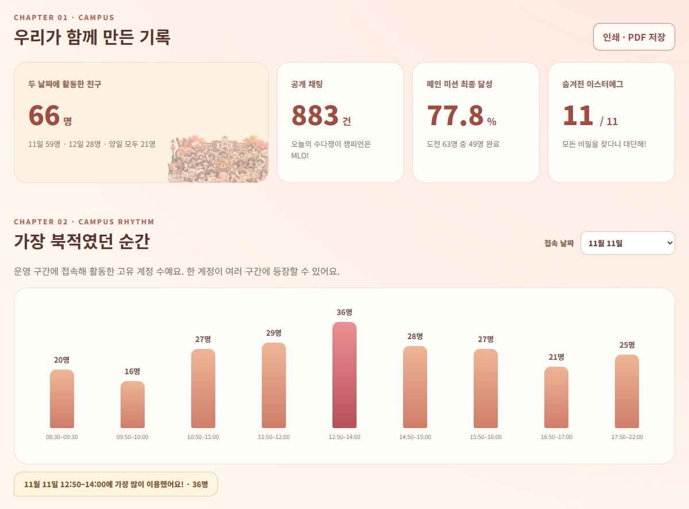
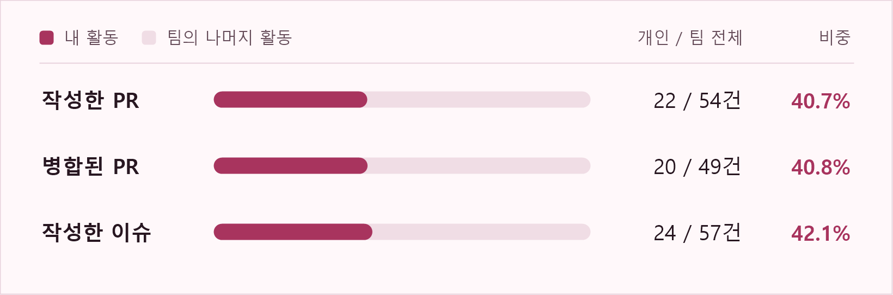

# PLAYDATA METAVERSE 개인 포트폴리오

**이재원 ([vvjeffvv3](https://github.com/vvjeffvv3)) · 5인 팀 프로젝트 · 이벤트 및 플랫폼 구현**

부트캠프 수강생을 위한 상시 메타버스 캠퍼스를 만들고, 같은 공간을 11월 11일 빼빼로데이 이벤트 맵으로 확장해 운영했습니다.

| 3차 · 기본 메타버스 캠퍼스 | 4차 · 빼빼로데이 이벤트 맵 |
| --- | --- |
|  |  |
| 18층 캠퍼스와 옥상에서 아바타로 이동하며 채팅, 게시판, Python·SQL 학습교실을 이용합니다. | 시즌 장식, NPC 추리 미션, 옥상 미션룸, 미니게임과 완료 보상을 추가했습니다. 화면은 행사 전 부하 시험에서 촬영했습니다. |
| [기본 캠퍼스 시연 영상 · 35초](assets/videos/original-service-demo.mp4) | [이벤트 플레이와 운영 결과](#4차-빼빼로데이-이벤트) |

## 4차 빼빼로데이 이벤트

**사라진 11번째 빼빼로**는 2026년 11월 11일에 진행한 추리 이벤트입니다. 플레이어는 탐정 꾸왕이의 의뢰를 받아 SQL로 수량 기록을 분석하고, 미니게임을 거쳐 직접 만든 빼빼로를 전달합니다. 전달을 마치면 완료 배지와 실제 보상 수령 안내를 받습니다. [이벤트 플레이 흐름과 화면](https://github.com/encore-ai-campus/mlo-01-p4-team2/blob/main/PRODUCT.md)

### 실제 행사 이용량

행사 결과 대시보드의 2026년 11월 11일~12일 14:00 KST 통합 집계입니다.

| 지표 | 관측값 |
| --- | --- |
| 운영 시간에 유효한 접속이 있었던 고유 계정 | **70개** |
| 로그인·로그아웃 외 활동이 기록된 고유 계정 | **66개** · 양일 모두 활동한 계정 21개 포함 |
| 가장 많은 계정이 활동한 집계 구간 | **36개** · 11월 11일 12:50~14:00에 접속해 활동한 고유 계정 |
| 공식 게임 시작 / 공개 채팅 | **1,463회 / 883건** |
| 메인 미션 완료 | **49개 계정** · 도전 63개 계정 중 **77.8%** |

행사 결과 대시보드 캡처

[집계 정의와 자료 출처](docs/demo.md#행사-결과-대시보드)

### 부하 시험과 성능 개선

| 팀 검증 항목 | 조건과 결과 |
| --- | --- |
| 온프레미스 동시 접속 시험 | **120개 계정 시도, 120개 연결 완료.** 강의실 경로에서 상호작용 오류가 남았습니다. 200개 계정 시험에서는 19초 안정 구간 기준 104개가 연결됐습니다. |
| 실시간 이동 응답 | 동일 로컬 조건에서 20개 계정으로 시험했을 때, **키 입력 → 이동 반영 P95 2,197ms → 7ms**. |
| 첫 접속 로딩 | 시작 층을 우선 준비하도록 바꾼 뒤 **23.4초 → 11.6초**, 입장 이미지 **51.6MB → 25.0MB**. 별도의 WebP 전환 측정에서는 **11.7초 → 6.6초**. |

팀은 행사 전에 연결이 몰리는 상황과 플레이 중 이동 응답을 측정했습니다. 저는 PR #66에서 **시작 층 우선 로딩과 입장 안내**를 구현해, 플레이어가 첫 화면을 준비하는 동안 다음 행동을 알 수 있게 했습니다. [팀 성능 측정과 시험 조건](https://github.com/encore-ai-campus/mlo-01-p4-team2#성능-개선과-검증)

## 대표 기여 · 미션 완료 배지와 이벤트 입장 흐름 (PR #66)

**제가 맡은 작업은 플레이어가 캠퍼스에 들어와 미션을 시작하고, 선물 전달을 마친 뒤 달성 결과를 확인하는 흐름을 개선하는 것이었습니다.** 서버의 미션 완료 기록을 배지·보상 안내·공유 화면에 연결하고, 첫 접속 때 필요한 이미지와 이용 안내를 정리했습니다.

| 작업 | 제가 구현한 내용 |
| --- | --- |
| **완료 배지 판정** | Django에서 계정별 최종 선물 전달 기록과 완료 시각을 읽어 **‘꾸왕이의 명예 조수’** 배지의 달성 상태를 반환했습니다. 기존 완료 기록을 재사용해 이미 미션을 끝낸 계정도 바로 배지를 확인할 수 있게 했습니다. |
| **완료 화면과 공유** | 최종 전달이 확인되면 배지와 보상 수령일을 보여주고, 사건 해결 이미지 링크를 복사할 수 있게 했습니다. 완료 화면을 닫은 뒤에는 수사수첩에서 배지를 다시 열 수 있도록 연결했습니다. |
| **입장 로딩과 이용 안내** | 시작 층에 필요한 이미지를 먼저 불러오고 서버 연결을 확인한 뒤 조작을 열었습니다. 나머지 이미지는 입장 후 불러오도록 했습니다. 이벤트 가이드에는 의뢰 시작 위치, 옥상 미션룸으로 가는 길, 상호작용 키를 정리했습니다. |

**검증** · 미완료 계정, 최종 전달 재요청, 관리자 미리보기에서 배지와 완료 기록이 의도대로 처리되는지 확인하는 Django 테스트를 추가했습니다. 입장 로딩에는 시작 층 우선 로딩, 서버 연결 대기, 이미지 로딩 실패 시 재시도를 확인하는 테스트를 추가했습니다.

**공개 검토 자료** · [완료 배지·공유 이미지](https://github.com/encore-ai-campus/mlo-01-p4-team2/blob/main/docs/product/event-complete-share.png) · [완료 배지·안내 변경 커밋](https://github.com/encore-ai-campus/mlo-01-p4-team2/commit/1ea64ab8b52ea920006592fcd5c03f319c4c09de) · [입장 로딩 테스트](https://github.com/encore-ai-campus/mlo-01-p4-team2/blob/main/platform_server/frontend/tests/entry-loading.test.cjs) · [실행 화면과 검증 자료](docs/demo.md)

## 협업과 기여 기록

2026년 11월 16일 기준으로, 메타버스 팀 저장소 전체 기록 중 제 계정(`vvjeffvv3`)이 작성한 건수의 비중입니다. 병합된 PR 20건은 작성한 PR 22건에 포함되며, 나머지 2건은 병합 없이 종료됐습니다. [집계 기준과 원본 기록](docs/contributions.md)

## 3차 기본 캠퍼스와 시연 영상

3차 프로젝트에서는 수강생이 평소에 이동하고, 소통하고, 학습할 수 있는 상시 캠퍼스를 만들었습니다. 저는 플랫폼 팀에서 **계정·아바타·이동·커뮤니티와 활동 이벤트 기록**을 맡았습니다. [3차 팀 프로젝트와 역할](https://github.com/encore-ai-campus/mlo-01-p3-team2#1-팀-소개)

[기본 캠퍼스 시연 영상 보기](assets/videos/original-service-demo.mp4) · 약 35초 · 18층 이동, 게시판, 옥상 공간

[기본 캠퍼스 실행 화면과 서비스 소개 자료](docs/demo.md#3차-기본-캠퍼스)

## 그 밖의 개인 기여

### 4차 이벤트 운영과 게임 콘텐츠

이벤트 운영 제어, 18층 게임과 이동 처리, 미션룸의 조작과 안내를 개선했습니다.

| 작업 | 관련 PR 번호 |
| --- | --- |
| 이벤트 운영 제어와 18층 게임·이동 처리 개선 | #82 |
| 히든 에피소드와 전역 업적 연결 | #60 |
| 미니게임 단말 배치, 레시피 발견 연출과 공유 수첩 | #52 |
| ROOM1 SQL 문제 테이블과 문제 좌우 배치 | #59 |
| 18층 게임 성공 기준 40초 및 Ctrl 표기 수정 | #93 |
| 관리자 이스터에그 획득 차단과 운영팀 골드 아바타 지원 | #97 |

[이벤트 운영과 게임 흐름 기록](docs/case-studies/event-operations.md) · [미니게임과 이벤트 맵 검증 화면](docs/demo.md#4차-빼빼로데이-이벤트)

### 플랫폼 공통 기능과 별도 시즌 콘텐츠

게시판의 조회 경로와 삭제 기록을 개선했습니다. 별도 크리스마스 콘텐츠에서는 빌리지·산타 NPC와 입장·층 이동 연출을 구현하는 작업에 참여했습니다.

| 작업 | 관련 PR 번호 |
| --- | --- |
| 게시판 조회를 PostgreSQL 세컨더리로 분리 | #87 |
| 게시글 삭제 시 댓글·대댓글 Outbox 기록 | #108 |
| 크리스마스 빌리지·산타 NPC와 접속·층 이동 연출 | #68 |

[게시판 조회와 변경 기록](docs/case-studies/board-data-flow.md) · [구조와 데이터 흐름](docs/architecture.md)

## 이벤트 메인 미션 데이터 구조

원본의 PostgreSQL 메인 미션 ERD를 가져왔습니다. 2026년 11월 3일 기준 문서이며, 단계 진행 상태와 게임 한 판의 기록을 분리한 구조를 보여줍니다.

- [테이블 관계와 컬럼 설명](docs/reference/main-mission-erd.md)
- [ERD HTML 원본](assets/diagrams/main-mission/index.html) — 다운로드 후 브라우저에서 열면 확대와 테이블 검색 가능
- [스키마 JSON](assets/diagrams/main-mission/schema.json)
- [플랫폼 구조와 요청 흐름](docs/architecture.md)

구조 자료는 팀 프로젝트 전체의 설계 참고 자료입니다. 개인 담당 작업은 위의 개인 기여 설명과 구분합니다.

## 팀 구성

원본 소개 문서에 기재된 역할입니다.

| 이름 | 담당 | GitHub |
| --- | --- | --- |
| 이재원 | 플랫폼 | [vvjeffvv3](https://github.com/vvjeffvv3) |
| 강한솔 | 플랫폼 | [hansolsmart](https://github.com/hansolsmart) |
| 신동엽 | 데이터 파이프라인 | [sdyeob](https://github.com/sdyeob) |
| 김남동 | 광고 서버 | [rlaskaehd](https://github.com/rlaskaehd) |
| 조성현 | 인프라 구축 | [seonghyeonjo2](https://github.com/seonghyeonjo2) |

## 공개 자료와 출처

이 포트폴리오는 공개 저장소입니다. [기본 캠퍼스 시연 영상](assets/videos/original-service-demo.mp4), [행사 대시보드와 실행 화면](docs/demo.md), [개인 기여 기록](docs/contributions.md)은 로그인 없이 볼 수 있습니다. 촬영·검증 조건과 [자료 출처](docs/reference/source-materials.md)도 함께 공개합니다.

## 문서와 작업공간

| 위치 | 내용 |
| --- | --- |
| [프로젝트 개요](docs/overview.md) | 서비스 목적과 기본 정보 |
| [개인 기여](docs/contributions.md) | 집계 기준과 원본 참고 링크 |
| [기능별 사례](docs/case-studies/README.md) | 구현 설명과 작성 템플릿 |
| [구조와 데이터 흐름](docs/architecture.md) | 구조도와 기술 선택 |
| [별도 데모](demo/README.md) | 독립 실행 데모를 추가할 공간 |
| [작업 목록](WORKSPACE.md) | 다음 작업과 완료 기준 |

프로젝트 기간과 팀 구성, 사례별 변경 파일, 실행 화면, 검증 결과는 작업 목록에 따라 보완합니다.

비공개 원본 작업 기록 · 팀 저장소 열람 권한 필요

- [원본 팀 저장소](https://github.com/playdatametaverse/playdatametaverse)
- [원본 PR #66](https://github.com/playdatametaverse/playdatametaverse/pull/66)
- [개인 작성 PR 목록](https://github.com/playdatametaverse/playdatametaverse/pulls?q=is%3Apr+author%3Avvjeffvv3)
- [개인 작성 이슈 목록](https://github.com/playdatametaverse/playdatametaverse/issues?q=is%3Aissue+author%3Avvjeffvv3)

