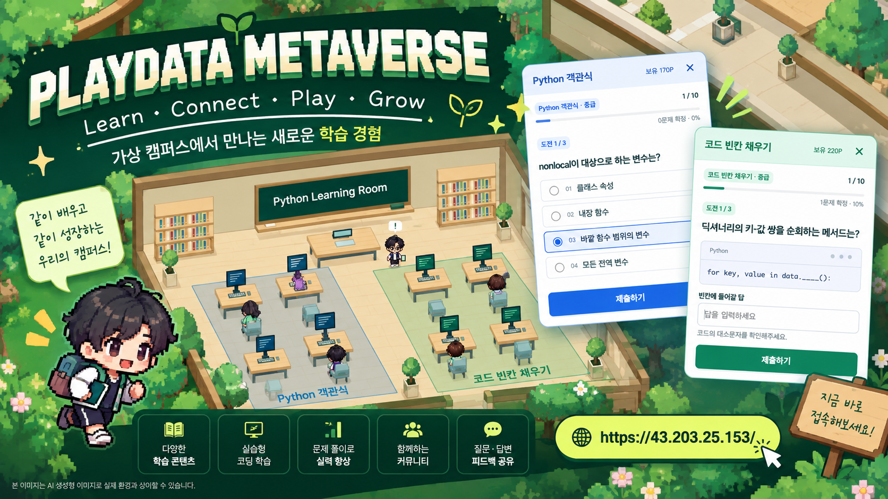
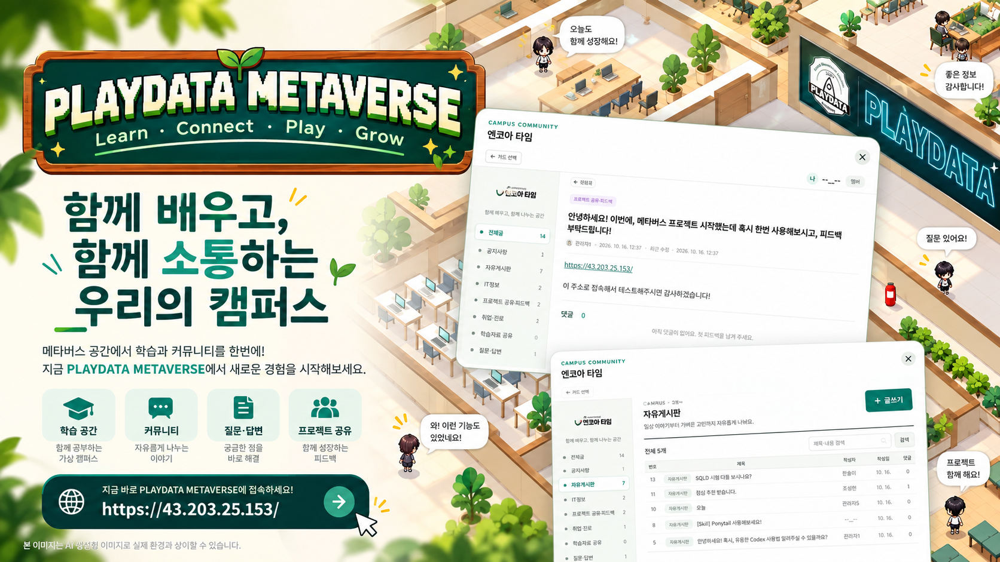
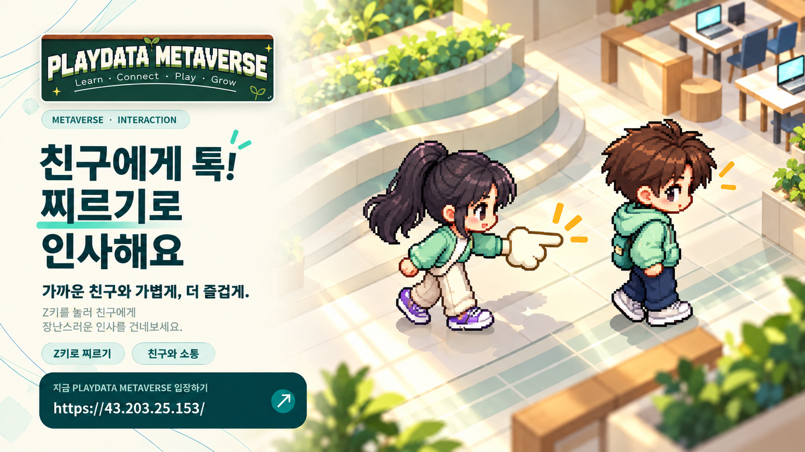
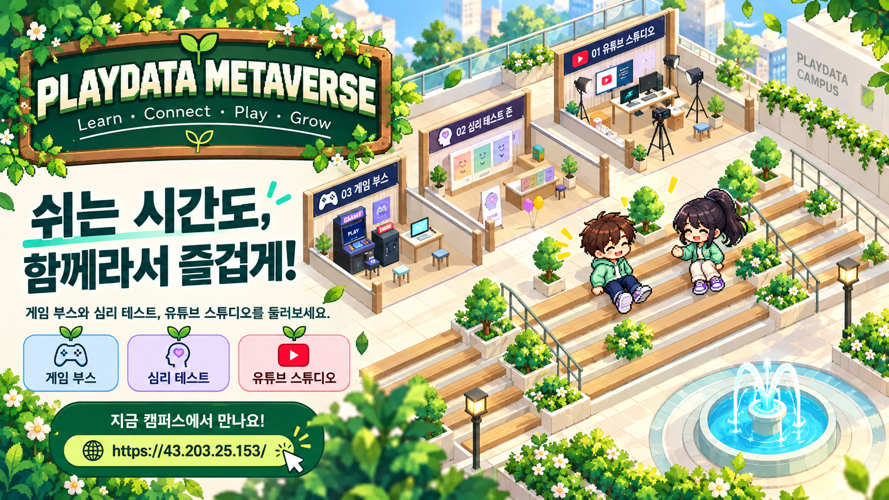
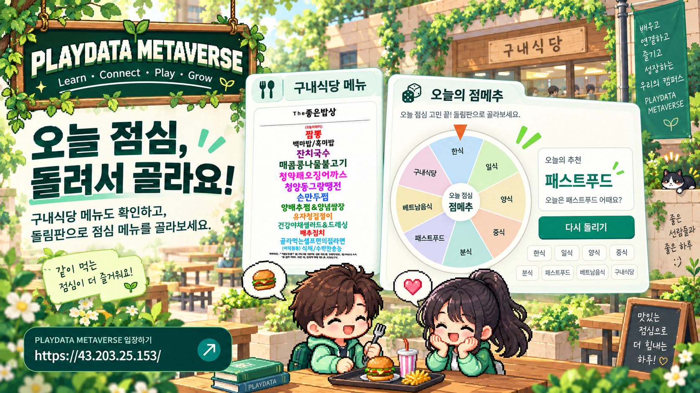
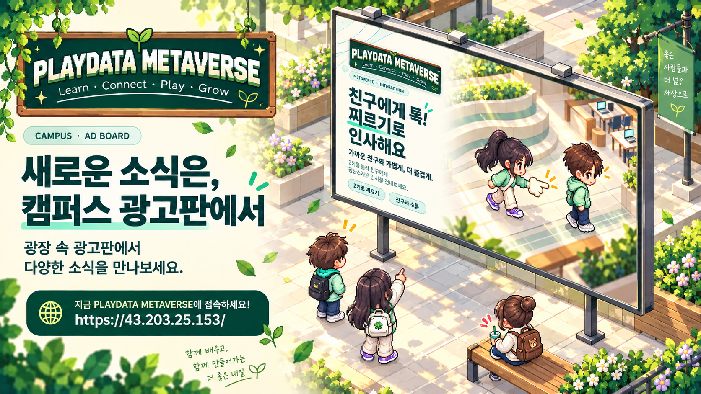
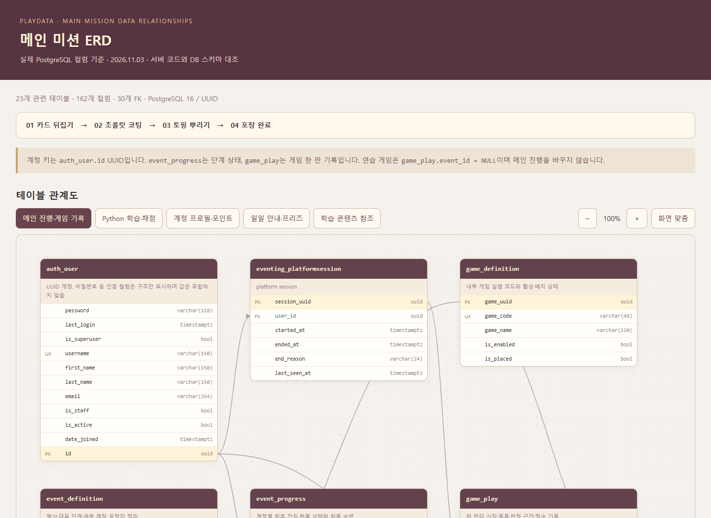

# PLAYDATA METAVERSE 개인 포트폴리오

학습하고 소통하는 메타버스 공간을 만드는 팀 프로젝트입니다. 이 저장소는 **vvjeffvv3가 참여한 이벤트·게임 콘텐츠, 이용 흐름 개선, 게시판 데이터 처리 작업**을 정리합니다.

> 포트폴리오 정리 중입니다. 현재는 설명 문서와 자료 폴더가 있으며, 실행 가능한 전체 서비스 코드는 포함되어 있지 않습니다.

## 프로젝트 소개

PLAYDATA METAVERSE는 가상 공간에서 이동하며 학습 콘텐츠, 소통 기능, 이벤트와 게임을 이용하는 서비스입니다. 개인 작업은 새로운 콘텐츠를 추가하는 영역과 기존 이용 흐름 및 데이터 처리를 개선하는 영역에 걸쳐 있습니다.

| 항목 | 내용 |
| --- | --- |
| 프로젝트 형태 | 팀 프로젝트 |
| 개인 계정 | [vvjeffvv3](https://github.com/vvjeffvv3) |
| 주요 작업 영역 | 이벤트 운영, 게임과 미션, 입장·이동 경험, 게시판 조회 및 변경 기록 |
| 원본 코드와 협업 기록 | 팀 비공개 저장소에서 관리 |
| 현재 공개 자료 | 원본 소개 이미지 8장, 메인 미션 ERD, 구조 설명, 개인 기여 기록 |

## 개인 담당 작업

아래 내용은 개인 작성 PR에서 확인한 작업 주제를 요약한 것입니다. 구체적인 설계와 검증 결과는 기능별 문서에 보완합니다.

### 이벤트 운영과 게임 콘텐츠

이벤트 운영 제어와 18층 게임·이동 처리를 개선했습니다. 계절 콘텐츠로는 크리스마스 빌리지와 산타 NPC, 접속 및 층 이동 연출을 추가하는 작업에 참여했습니다.

미션 완료 경험에서는 완료 배지와 공유 기능, 입장 로딩과 이용 안내를 다뤘습니다. 콘텐츠를 구현하는 작업과 함께 사용자가 입장하고 이동하고 완료 결과를 확인하는 흐름을 정리했습니다.

| 작업 | 관련 PR 번호 |
| --- | --- |
| 이벤트 운영 제어와 18층 게임·이동 처리 개선 | #82 |
| 크리스마스 빌리지·산타 NPC와 접속·층 이동 연출 | #68 |
| 메인 미션 완료 배지·공유와 입장 로딩·이용 안내 | #66 |
| 히든 에피소드와 전역 업적 연결 | #60 |
| 미니게임 단말 배치, 레시피 발견 연출과 공유 수첩 | #52 |

[이벤트 운영과 게임 흐름 기록](docs/case-studies/event-operations.md)

### 이용 화면과 조작 흐름

ROOM1 SQL 문제의 테이블과 좌우 배치를 수정하고, 게임 성공 기준 및 조작 키 표기를 조정했습니다. 관리자 이스터에그 획득 차단과 운영팀 골드 아바타 지원 등 운영자와 일반 사용자의 이용 조건을 구분하는 작업도 수행했습니다.

| 작업 | 관련 PR 번호 |
| --- | --- |
| ROOM1 SQL 문제 테이블과 문제 좌우 배치 | #59 |
| 18층 게임 성공 기준 40초 및 Ctrl 표기 수정 | #93 |
| 관리자 이스터에그 획득 차단과 운영팀 골드 아바타 지원 | #97 |

### 게시판 조회와 데이터 변경 기록

게시판 조회를 PostgreSQL 세컨더리로 분리하는 작업과, 게시글 삭제 시 댓글·대댓글의 Outbox 기록을 추가하는 작업을 수행했습니다. 조회 경로와 데이터 변경 기록을 각각 다룬 사례입니다.

| 작업 | 관련 PR 번호 |
| --- | --- |
| 게시판 조회를 PostgreSQL 세컨더리로 분리 | #87 |
| 게시글 삭제 시 댓글·대댓글 Outbox 기록 | #108 |

데이터 흐름, 적용 범위, 실패 시 동작은 원본 변경 파일과 확인 기록을 바탕으로 사례 문서에 정리할 예정입니다.

[게시판 조회와 변경 기록](docs/case-studies/board-data-flow.md) · [구조와 데이터 흐름](docs/architecture.md)

## 협업과 기여 기록

**2026년 11월 16일 확인한 팀 저장소 기록**입니다.

| 활동 | 개인 기록 | 집계 기준 |
| --- | ---: | --- |
| 작성한 PR | 22건 | 작성자 vvjeffvv3 |
| 병합된 PR | 20건 | 작성한 PR 중 병합 완료 |
| 병합 없이 닫힌 PR | 2건 | 작성한 PR 중 미병합 종료 |
| 작성한 이슈 | 24건 | 작성자 vvjeffvv3 |

PR와 이슈 수는 협업 활동 지표입니다. 같은 기능의 이슈와 PR를 각각 독립적인 개발 작업으로 합산하거나, PR 비중을 전체 개발 기여율로 사용하지 않습니다.

[전체 집계 기준과 대표 기록](docs/contributions.md)

## 대표 사례에서 설명할 내용

| 사례 | 설명할 핵심 내용 | 추가할 자료 |
| --- | --- | --- |
| 이벤트 운영과 게임 흐름 | 운영 제어, 게임과 이동, 미션 완료 흐름에서 개인이 수정한 범위 | 변경 전후 화면, 동작 설명 |
| 게시판 조회 분리 | 조회 요청의 경로, 적용 범위와 설계 선택 | 데이터 흐름도, 확인 결과 |
| 삭제와 Outbox 기록 | 게시글·댓글·대댓글 삭제와 기록 처리의 관계 | 처리 순서, 정상·실패 상황 확인 결과 |

각 사례는 문제 상황, 개인 담당 범위, 구현 선택, 확인 결과, 남은 개선점 순서로 작성합니다. 성능 수치를 추가할 때는 측정 환경과 비교 조건을 함께 기록합니다.

## 실제 실행 화면과 시연 영상

원본 문서의 시연 영상과 개발·검증 과정에 저장된 브라우저 캡처를 가져왔습니다. 아래 자료는 위의 AI 홍보 이미지와 구분되는 실제 애플리케이션 화면입니다. 촬영 당시 버전이며 최신 운영 상태를 의미하지 않습니다.

### 원본 서비스 시연 영상

[시연 영상 보기 또는 다운로드](assets/videos/original-service-demo.mp4) · 약 35초 · MP4 · 1920×940

원본 소개 문서에 연결된 영상을 파일로 옮겼습니다. 비공개 원본의 열람 권한 없이 이 저장소에서 확인할 수 있습니다.

### 캠퍼스 실행 화면

2026년 10월 15일 UI 확인 자료입니다. 캐릭터, 캠퍼스 공간, 이동과 상호작용 안내가 보입니다.

### 이벤트와 게임 실행 화면

2026년 11월 6일 부하 시험 중 브라우저 캡처입니다. 표시된 접속자 수는 시험 장면의 값이며 서비스 처리량이나 실사용자 통계로 해석하지 않습니다.

2026년 11월 7일 검증 자료의 게임 시작과 단계 완료 화면입니다.

[쪽지함 테스트, 모바일 로딩 등 전체 캡처와 출처](docs/demo.md)

## 원본에서 가져온 서비스 소개 자료

원본 팀 저장소의 소개 이미지입니다. **AI로 구성한 홍보 이미지가 포함되어 있어 실제 실행 화면과 차이가 있으며, 개인 구현 결과를 증명하는 캡처로 사용하지 않습니다.** 이미지 안의 접속 주소는 제작 당시 안내입니다.

### 학습교실

Python·SQL 문제 풀이, 코드 빈칸과 오답 복습을 소개합니다.

### 커뮤니티와 소통

게시판에서 질문과 학습 자료를 나누고, 가까운 동료에게 찌르기로 인사하는 기능을 소개합니다.

찌르기, 옥상, 식단과 광고 소개 더 보기

## 메인 미션 데이터 구조

원본의 PostgreSQL 메인 미션 ERD를 가져왔습니다. 2026년 11월 3일 기준 문서이며, 단계 진행 상태와 게임 한 판의 기록을 분리한 구조를 보여줍니다.

- [테이블 관계와 컬럼 설명](docs/reference/main-mission-erd.md)
- [ERD HTML 원본](assets/diagrams/main-mission/index.html) — 다운로드 후 브라우저에서 열면 확대와 테이블 검색 가능
- [스키마 JSON](assets/diagrams/main-mission/schema.json)
- [플랫폼 구조와 요청 흐름](docs/architecture.md)

구조 자료는 팀 프로젝트 전체의 설계 참고 자료입니다. 개인 담당 작업은 위의 개인 기여 설명과 구분합니다.

## 팀 구성

원본 소개 문서에 기재된 역할입니다.

| 이름 | 담당 | GitHub |
| --- | --- | --- |
| 이재원 | 플랫폼 | [vvjeffvv3](https://github.com/vvjeffvv3) |
| 강한솔 | 플랫폼 | [hansolsmart](https://github.com/hansolsmart) |
| 신동엽 | 데이터 파이프라인 | [sdyeob](https://github.com/sdyeob) |
| 김남동 | 광고 서버 | [rlaskaehd](https://github.com/rlaskaehd) |
| 조성현 | 인프라 구축 | [seonghyeonjo2](https://github.com/seonghyeonjo2) |

## 시연 자료와 출처

[공개 자료 목록](docs/demo.md)에서 가져온 이미지와 설계 문서를 확인할 수 있습니다. 원본 시연 영상과 실제 브라우저 캡처를 이 저장소에 옮겼습니다. 촬영 버전과 테스트 조건은 공개 자료 목록에 표시했습니다.

자료의 원본 경로, 브랜치와 커밋은 [자료 출처](docs/reference/source-materials.md)에 기록했습니다.

## 문서와 작업공간

| 위치 | 내용 |
| --- | --- |
| [프로젝트 개요](docs/overview.md) | 서비스 목적과 기본 정보 |
| [개인 기여](docs/contributions.md) | 집계 기준과 원본 참고 링크 |
| [기능별 사례](docs/case-studies/README.md) | 구현 설명과 작성 템플릿 |
| [구조와 데이터 흐름](docs/architecture.md) | 구조도와 기술 선택 |
| [별도 데모](demo/README.md) | 독립 실행 데모를 추가할 공간 |
| [작업 목록](WORKSPACE.md) | 다음 작업과 완료 기준 |

프로젝트 기간과 팀 구성, 사례별 변경 파일, 실행 화면, 검증 결과는 작업 목록에 따라 보완합니다.

## 원본 저장소 열람 안내

원본 팀 저장소는 비공개이므로 외부 방문자는 아래 코드·PR·이슈 링크를 열 수 없습니다. 링크는 원본 열람 권한이 있는 사람을 위한 참고 자료이며, 공개 포트폴리오의 기능 설명은 위 본문과 이 저장소의 문서에서 확인할 수 있습니다.

- [원본 팀 저장소 — 접근 권한 필요](https://github.com/playdatametaverse/playdatametaverse)
- [개인 작성 PR 목록 — 접근 권한 필요](https://github.com/playdatametaverse/playdatametaverse/pulls?q=is%3Apr+author%3Avvjeffvv3)
- [개인 작성 이슈 목록 — 접근 권한 필요](https://github.com/playdatametaverse/playdatametaverse/issues?q=is%3Aissue+author%3Avvjeffvv3)

소개 이미지와 ERD는 이 저장소에 복사해 외부에서도 열람할 수 있습니다. 실제 실행 캡처와 시연 영상도 이 저장소에서 열람할 수 있습니다.
