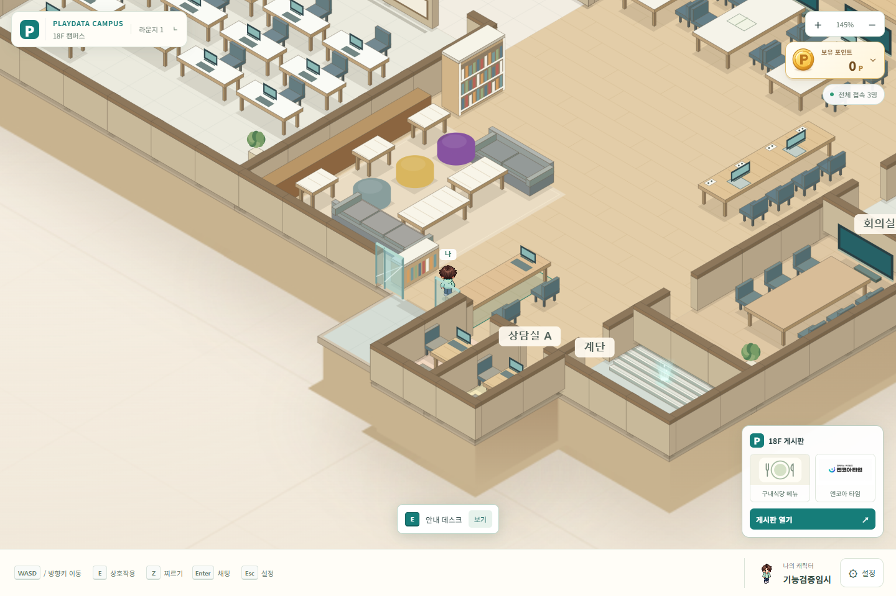
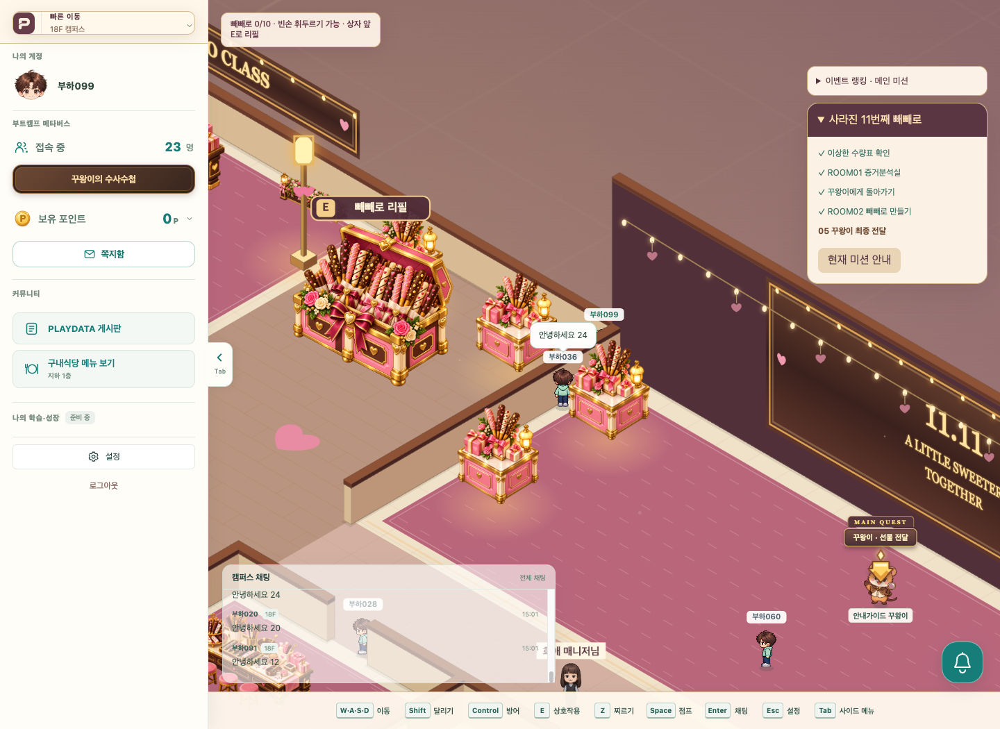
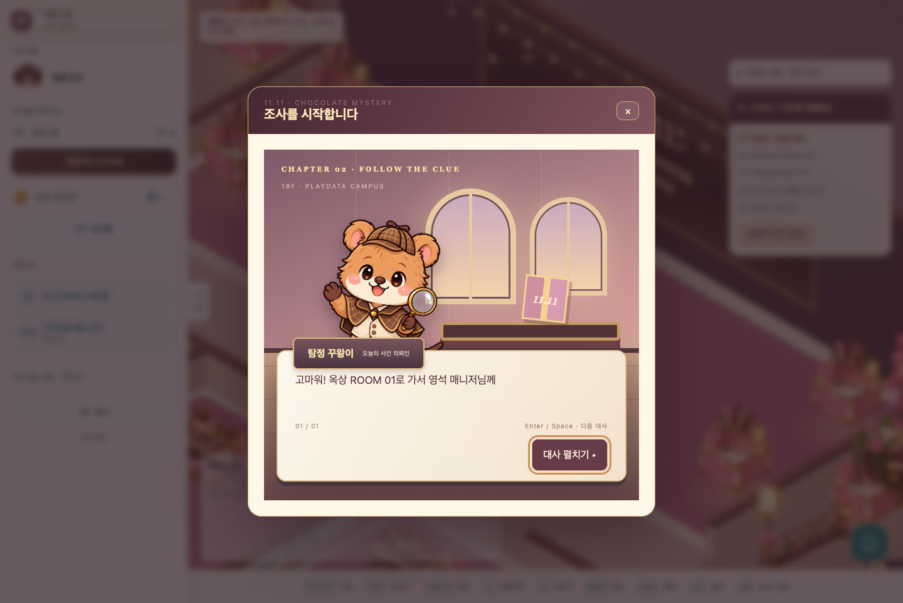
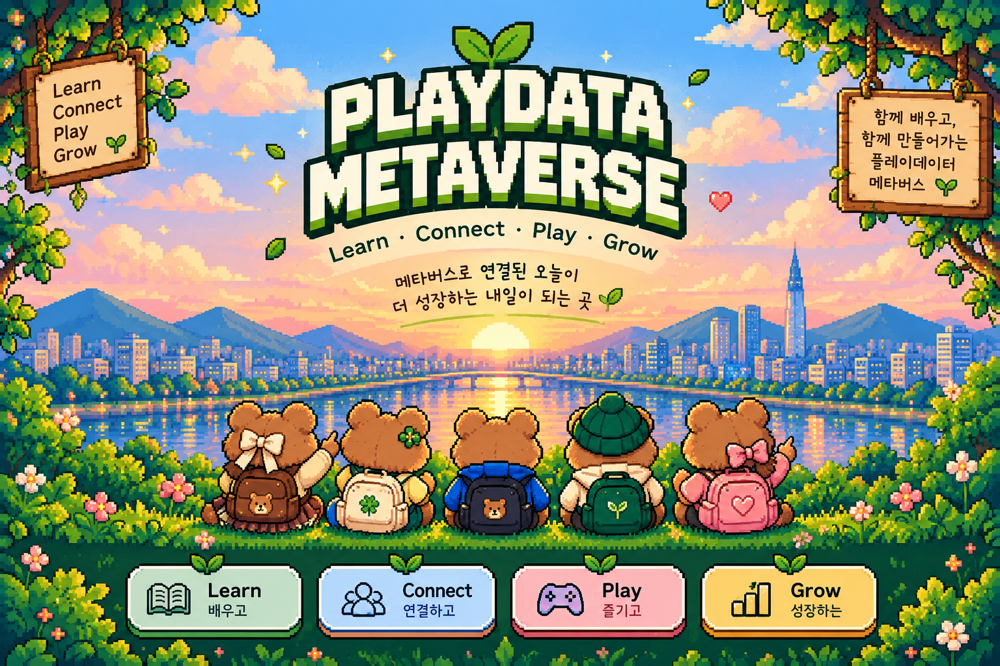

# PLAYDATA METAVERSE 개인 포트폴리오

**이재원 ([vvjeffvv3](https://github.com/vvjeffvv3)) · 5인 팀 프로젝트 · 이벤트 및 플랫폼 구현**

부트캠프 수강생을 위한 **3차 메타버스 앱**을 만들고, **4차에서 빼빼로데이 추리 이벤트**를 열었습니다. 행사 준비 과정에서 플레이어 안내와 운영 도구를 갖추고, 접속과 이동 성능을 측정해 개선했습니다.

[3차 메타버스 앱과 시연](#3차-메타버스-앱) · [4차 빼빼로데이 이벤트](#4차-빼빼로데이-이벤트) · [사용자 편의와 운영 도구](#사용자-편의와-운영-도구) · [부하 시험과 성능 개선](#부하-시험과-성능-개선) · [브랜딩](#브랜딩)

## 3차 메타버스 앱

### 기본 캠퍼스 시연 영상

https://github.com/user-attachments/assets/1a88be7e-7d3f-4d0a-8036-f4b4ca2c817a

[MP4 파일 열기](assets/videos/original-service-demo.mp4) · 약 35초 · 18층 이동, 게시판, 옥상 공간

수강생이 아바타로 18층 캠퍼스와 옥상을 오가며 실시간 채팅, 게시판, Python·SQL 학습교실을 이용하는 상시 서비스입니다. 저는 플랫폼 팀에서 **계정·아바타·이동·커뮤니티와 활동 이벤트 기록**을 담당했습니다. [3차 제품 소개](https://github.com/encore-ai-campus/mlo-01-p3-team2/blob/main/PRODUCT.md) · [팀 구성과 역할](https://github.com/encore-ai-campus/mlo-01-p3-team2#1-팀-소개)

## 4차 빼빼로데이 이벤트

**사라진 11번째 빼빼로**는 2026년 11월 11일에 진행한 추리 이벤트입니다. 기본 캠퍼스의 18층과 옥상을 행사장으로 바꾸고, 이벤트 전용 미션룸과 미니게임을 추가했습니다. [이벤트 플레이 흐름과 화면](https://github.com/encore-ai-campus/mlo-01-p4-team2/blob/main/PRODUCT.md)

**플레이 흐름** · 꾸왕이에게 의뢰 받기 → 옥상 증거분석실에서 SQL 단서 확인 → 미니게임과 빼빼로 제작 → 선물 전달 → 완료 배지와 보상 안내

| 이벤트 맵 | 탐정 꾸왕이와 조사 시작 |
| --- | --- |
|  |  |
| 행사 전 부하 시험 | 미션 진행 검증 |

### 대표 기여 · 미션 완료 배지와 이벤트 입장 흐름 (PR #66)

**제가 맡은 작업은 플레이어가 캠퍼스에 들어와 미션을 시작하고, 선물 전달을 마친 뒤 달성 결과를 확인하는 흐름을 개선하는 것이었습니다.** 서버의 미션 완료 기록을 배지·보상 안내·공유 화면에 연결하고, 첫 접속 때 필요한 이미지와 이용 안내를 정리했습니다.

| 개인 담당 범위 | PR #66에 반영한 내용 |
| --- | --- |
| **완료 배지 판정** | Django에서 계정별 최종 선물 전달 기록과 완료 시각을 읽어 **‘꾸왕이의 명예 조수’** 배지의 달성 상태를 반환했습니다. 기존 완료 기록을 재사용해 이미 미션을 끝낸 계정도 바로 배지를 확인할 수 있게 했습니다. |
| **완료 화면과 공유** | 최종 전달이 확인되면 배지와 보상 수령일을 보여주고, 사건 해결 이미지 링크를 복사할 수 있게 했습니다. 완료 화면을 닫은 뒤에는 수사수첩에서 배지를 다시 열 수 있도록 연결했습니다. |
| **입장 로딩과 이용 안내** | 시작 층에 필요한 이미지를 먼저 불러오고 서버 연결을 확인한 뒤 조작을 열었습니다. 나머지 이미지는 입장 후 불러오도록 했습니다. 이벤트 가이드에는 의뢰 시작 위치, 옥상 미션룸으로 가는 길, 상호작용 키를 정리했습니다. |

**검증** · PR에는 미완료 계정, 최종 전달 재요청, 관리자 미리보기의 배지 판정 테스트와 시작 층 우선 로딩, 서버 연결 대기, 이미지 실패 시 재시도 테스트를 포함했습니다.

**공개 검토 자료** · [완료 배지·공유 이미지](https://github.com/encore-ai-campus/mlo-01-p4-team2/blob/main/docs/product/event-complete-share.png) · [완료 배지·안내 변경 커밋](https://github.com/encore-ai-campus/mlo-01-p4-team2/commit/1ea64ab8b52ea920006592fcd5c03f319c4c09de) · [입장 로딩 테스트](https://github.com/encore-ai-campus/mlo-01-p4-team2/blob/main/platform_server/frontend/tests/entry-loading.test.cjs) · [실행 화면과 검증 자료](docs/demo.md)

## 사용자 편의와 운영 도구

| 사용 상황 | 제공한 기능 |
| --- | --- |
| **플레이어 안내** | 접속 진행률과 재시도, 미션 가이드와 조작키 안내, 수사수첩에서 완료 배지 다시 보기, 공유 이미지 링크 복사 |
| **행사 운영** | 정해진 시간에 이벤트를 자동으로 열고, 운영자가 강제 개방·종료하거나 강의 시간 중 이용을 일시정지 |
| **매니저 대시보드** | 과정·기수별 계정 일괄 발급, 메인 미션·이스터에그 달성 확인, 보상 지급·취소 이력, CSV 내보내기 |
| **행사 결과 대시보드** | 접속과 활동 인원, 시간대별 이용, 미션 완료율, 게임 시작·순위를 운영 기록에서 집계 |

보상 지급 여부는 게임의 달성 기록을 통해 확인했습니다. 운영 대시보드는 계정 UUID로 게임 기록을 조회하고, 참가자 실명과 지급 이력은 매니저 PC에서 관리했습니다. [팀 제품 문서의 운영 대시보드](https://github.com/encore-ai-campus/mlo-01-p4-team2/blob/main/PRODUCT.md#3-운영-대시보드-4차)

### 실제 행사 이용량

행사 결과 대시보드의 2026년 11월 11일~12일 14:00 KST 통합 집계입니다.

| 지표 | 관측값 |
| --- | --- |
| 운영 시간에 유효한 접속이 있었던 고유 계정 | **70개** |
| 로그인·로그아웃 외 활동이 기록된 고유 계정 | **66개** · 양일 모두 활동한 계정 21개 포함 |
| 가장 많은 계정이 활동한 집계 구간 | **36개** · 11월 11일 12:50~14:00에 접속해 활동한 고유 계정 |
| 공식 게임 시작 / 공개 채팅 | **1,463회 / 883건** |
| 메인 미션 완료 | **49개 계정** · 도전 63개 계정 중 **77.8%** |

행사 결과 대시보드 캡처

[집계 정의와 자료 출처](docs/demo.md#행사-결과-대시보드)

## 부하 시험과 성능 개선

| 팀 검증 항목 | 조건과 결과 |
| --- | --- |
| 온프레미스 동시 접속 시험 | **120개 계정 시도, 120개 연결 완료.** 강의실 경로에서 상호작용 오류가 남았습니다. 200개 계정 시험에서는 19초 안정 구간 기준 104개가 연결됐습니다. |
| 실시간 이동 응답 | 동일 로컬 조건에서 20개 계정으로 시험했을 때, **키 입력 → 이동 반영 P95 2,197ms → 7ms**. |
| 첫 접속 로딩 | 시작 층을 우선 준비하도록 바꾼 뒤 **23.4초 → 11.6초**, 입장 이미지 **51.6MB → 25.0MB**. 별도의 WebP 전환 측정에서는 **11.7초 → 6.6초**. |

팀은 행사 전에 연결이 몰리는 상황과 플레이 중 이동 응답을 측정했습니다. 저는 PR #66에서 **시작 층 우선 로딩과 입장 안내**를 맡았습니다. [팀 성능 측정과 시험 조건](https://github.com/encore-ai-campus/mlo-01-p4-team2#성능-개선과-검증)

### AI 활용 · 빼빼로데이 입장 화면

2026년 11월 8일, 로그인 뒤 이미지 준비가 길어지는 구간을 개선하기 위해 입장 화면을 제안했습니다. ImageGen으로 장면을 비교하고, Codex와 로딩 코드를 반영한 뒤 실제 브라우저에서 확인했습니다.

| 단계 | AI가 맡은 작업 | 제가 정한 방향과 검증 |
| --- | --- | --- |
| **시안 제작** | ImageGen이 아치를 지나기, 포털로 도착하기, 꾸왕이가 캠퍼스 문을 열어주기 세 가지 장면을 생성했습니다. | 캐릭터들이 **함께 행사장에 들어오는 느낌**을 요청했습니다. 세 시안을 보고 꾸왕이가 문을 열어 맞이하는 3번을 골랐습니다. |
| **입장 동작 구현** | Codex가 시작 층의 이미지와 서버 연결을 확인한 뒤 입장을 열도록 구현했습니다. 마지막 위치가 옥상인 재접속도 처리하고, 나머지 이미지는 입장 후 받도록 했습니다. | 18층에서 시작하는 이용자에게 **18층을 먼저 보여주고 옥상은 플레이 중에 준비하자**고 제안했습니다. 입장 준비가 끝나는 시점을 기준으로 화면이 전환되는 흐름을 채택했습니다. |
| **측정과 추가 개선** | Codex가 로컬 브라우저에서 첫 접속과 캐시 재접속을 측정했습니다. 추가 WebP 최적화 후 옥상 이동·재접속과 이미지 실패 후 재시도도 검증했습니다. | 재접속 때 이미지가 다시 내려오는지 확인을 요청하고 로컬 비교를 진행했습니다. **첫 접속 11.6초**는 행사 첫 방문자에게 여전히 길다고 판단해 추가 개선을 요청했습니다. |

**추가 WebP 최적화 측정** · 첫 접속은 **11.7초 → 6.6초**, 입장까지 이미지 전송량은 **25.0MB → 11.4MB**였습니다. 캐시가 있는 재접속은 **1.33초 → 2.18초**로 늘었습니다. 로컬 Edge에서 20Mbps, RTT 40ms, CPU 2배 감속 조건으로 각각 3회 측정한 중앙값입니다. [반영된 일러스트](https://github.com/encore-ai-campus/mlo-01-p4-team2/blob/main/platform_server/frontend/dist/assets/loading/pepero-arrival-v1.webp) · [로딩 코드와 입장 조건](https://github.com/encore-ai-campus/mlo-01-p4-team2/blob/main/platform_server/frontend/dist/entry-loading.js) · [팀 성능 기록](https://github.com/encore-ai-campus/mlo-01-p4-team2#성능-개선과-검증)

같은 PR의 완료 화면에서는 제가 **‘꾸왕이의 명예 조수’**라는 이름을 고르고, 보상 수령일과 이미지 링크 복사 기능을 요청했습니다. AI는 배지 아이콘을 생성하고 완료·공유 화면에 반영했습니다. [배지 제작 프롬프트](https://github.com/encore-ai-campus/mlo-01-p4-team2/blob/main/platform_server/frontend/dist/assets/achievements/kkuwang-honorary-assistant-v1.prompt.txt) · [완료 화면 변경 커밋](https://github.com/encore-ai-campus/mlo-01-p4-team2/commit/1ea64ab8b52ea920006592fcd5c03f319c4c09de)

## 브랜딩

| 3차 · PLAYDATA METAVERSE | 4차 · 사라진 11번째 빼빼로 |
| --- | --- |
|  |  |
| **Learn · Connect · Play · Grow**를 학습교실, 캠퍼스 커뮤니티, 옥상 콘텐츠로 소개했습니다. | 탐정 꾸왕이와 사건 모티프를 홍보물부터 입장 화면, 수사수첩과 완료 배지까지 이어 갔습니다. |

[원본 브랜딩·제품 소개 자료 모음](docs/branding.md)

## 협업과 기여 기록

2026년 11월 16일 기준으로, 메타버스 팀 저장소 전체 기록 중 제 계정(`vvjeffvv3`)이 작성한 건수의 비중입니다. 병합된 PR 20건은 작성한 PR 22건에 포함되며, 나머지 2건은 병합 없이 종료됐습니다. [집계 기준과 원본 기록](docs/contributions.md)

그 밖의 개인 작업과 팀 구성

#### 4차 이벤트 운영과 게임 콘텐츠

이벤트 운영 제어, 18층 게임과 이동 처리, 미션룸의 조작과 안내를 개선했습니다.

| 작업 | 관련 PR 번호 |
| --- | --- |
| 이벤트 운영 제어와 18층 게임·이동 처리 개선 | #82 |
| 히든 에피소드와 전역 업적 연결 | #60 |
| 미니게임 단말 배치, 레시피 발견 연출과 공유 수첩 | #52 |
| ROOM1 SQL 문제 테이블과 문제 좌우 배치 | #59 |
| 18층 게임 성공 기준 40초 및 Ctrl 표기 수정 | #93 |
| 관리자 이스터에그 획득 차단과 운영팀 골드 아바타 지원 | #97 |

[이벤트 운영과 게임 흐름 기록](docs/case-studies/event-operations.md) · [미니게임과 이벤트 맵 검증 화면](docs/demo.md#4차-빼빼로데이-이벤트)

#### 플랫폼 공통 기능과 별도 시즌 콘텐츠

게시판의 조회 경로와 삭제 기록을 개선했습니다. 별도 크리스마스 콘텐츠에서는 빌리지·산타 NPC와 입장·층 이동 연출을 구현하는 작업에 참여했습니다.

| 작업 | 관련 PR 번호 |
| --- | --- |
| 게시판 조회를 PostgreSQL 세컨더리로 분리 | #87 |
| 게시글 삭제 시 댓글·대댓글 Outbox 기록 | #108 |
| 크리스마스 빌리지·산타 NPC와 접속·층 이동 연출 | #68 |

[게시판 조회와 변경 기록](docs/case-studies/board-data-flow.md) · [구조와 데이터 흐름](docs/architecture.md)

#### 팀 구성

| 이름 | 담당 | GitHub |
| --- | --- | --- |
| 이재원 | 플랫폼 | [vvjeffvv3](https://github.com/vvjeffvv3) |
| 강한솔 | 플랫폼 | [hansolsmart](https://github.com/hansolsmart) |
| 신동엽 | 데이터 파이프라인 | [sdyeob](https://github.com/sdyeob) |
| 김남동 | 광고 서버 | [rlaskaehd](https://github.com/rlaskaehd) |
| 조성현 | 인프라 구축 | [seonghyeonjo2](https://github.com/seonghyeonjo2) |

## 공개 자료와 출처

- [시연 영상·실행 화면·행사 결과 대시보드](docs/demo.md)
- [브랜딩과 원본 서비스 소개](docs/branding.md)
- [기능별 사례와 PR 기록](docs/case-studies/README.md) · [개인 기여 기록](docs/contributions.md)
- [메인 미션 ERD](docs/reference/main-mission-erd.md) · [플랫폼 구조와 요청 흐름](docs/architecture.md)
- [자료 출처와 제작 기준](docs/reference/source-materials.md)

비공개 원본 작업 기록 · 팀 저장소 열람 권한 필요

- [원본 팀 저장소](https://github.com/playdatametaverse/playdatametaverse)
- [원본 PR #66](https://github.com/playdatametaverse/playdatametaverse/pull/66)
- [개인 작성 PR 목록](https://github.com/playdatametaverse/playdatametaverse/pulls?q=is%3Apr+author%3Avvjeffvv3)
- [개인 작성 이슈 목록](https://github.com/playdatametaverse/playdatametaverse/issues?q=is%3Aissue+author%3Avvjeffvv3)

