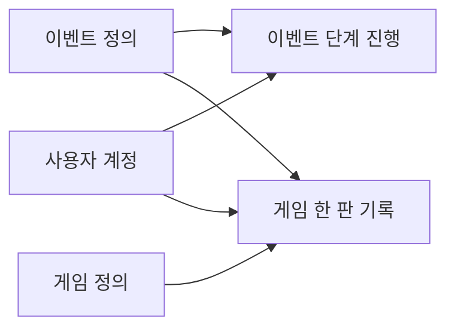
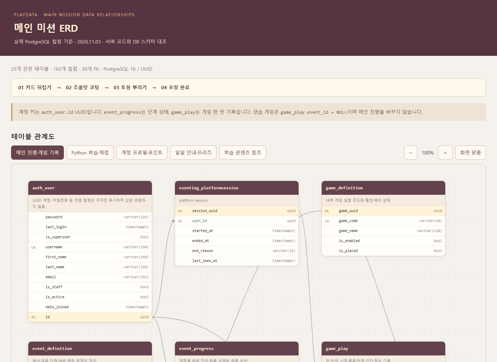

# 플랫폼 구조와 데이터 흐름

원본 `event` 브랜치의 README와 설계 문서를 기준으로 정리했습니다.

## 서비스 구성

| 구성 | 역할 |
| --- | --- |
| backend | Django Channels와 Daphne 기반 실시간 처리, 이동·채팅·학습·포인트 |
| frontend | Django 웹 화면, 캔버스 클라이언트와 지도 데이터 |
| Redis | 여러 소켓 프로세스 사이의 상태와 메시지 전달 |
| ad-bridge | 광고 서비스 연동 |
| loadtest | 부하 시험과 운영 측정 도구 |
| deploy | 배포와 롤백 설정 |

원본 event 브랜치 README는 PostgreSQL과 UUID 계정 키를 사용한다고 명시합니다.

## 메인 미션 데이터 흐름

원본 ERD에서 `event_progress`는 단계 상태, `game_play`는 한 판의 시작과 결과입니다. 연습 게임은 `game_play.event_id`가 NULL이며 메인 진행을 변경하지 않는 것으로 설명됩니다. 게임 성공과 단계 완료의 트랜잭션 처리 설명은 아래 원본 ERD에 있습니다.

[메인 미션 ERD 상세](reference/main-mission-erd.md) · [스키마 JSON](../assets/diagrams/main-mission/schema.json)

## 과거 요청 흐름 설계

[플랫폼 요청 흐름 원본 발췌](reference/platform-request-flow.md)에는 이동·채팅 Redis 분리, 프론트 중계와 WebSocket 직접 전달, 로그아웃 저장 ACK 순서가 있습니다.

이 문서는 MySQL 기반 과거 설계와 배포 예시를 포함합니다. 현재 PostgreSQL 기반 이벤트 구성과 구분하며 실제 운영 구조로 단정하지 않습니다. 전체 구조 자료는 팀 설계의 참고 자료이며 개인 단독 구현을 의미하지 않습니다.

[자료 출처](reference/source-materials.md)
