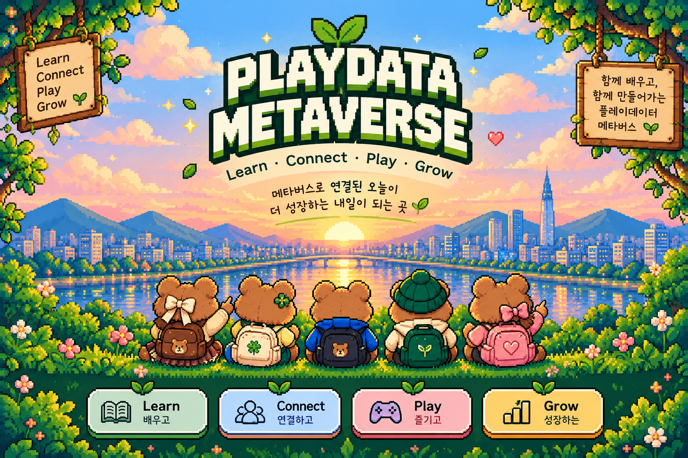

# PLAYDATA METAVERSE 브랜딩과 제품 소개

팀의 원본 서비스 소개 문서와 공개 3·4차 제품 문서에서 로고, 서비스 소개 이미지, 이벤트 홍보물을 모았습니다.

## 3차 캠퍼스 브랜드

캠퍼스 소개는 **Learn · Connect · Play · Grow**를 중심으로 구성했습니다. 수강생이 함께 배우고 소통하며, 쉬는 시간에 즐길 콘텐츠를 갖춘 공간을 보여주는 데 사용한 자료입니다.

| 소개 주제 | 원본 소개 자료 |
| --- | --- |
| 배우고 성장하기 | [Python·SQL 학습교실](../assets/overview/learning-classroom.png) |
| 캠퍼스에서 연결되기 | [게시판과 커뮤니티](../assets/overview/community-board.png) · [찌르기로 인사하기](../assets/overview/poke.png) |
| 쉬는 시간 즐기기 | [옥상 콘텐츠](../assets/overview/rooftop-fountain.png) · [식단과 점심 메뉴 추천](../assets/overview/lunch-menu.png) |
| 캠퍼스 소식 | [캠퍼스 광고판](../assets/overview/campus-ad-board.png) |

[3차 공개 제품 소개](https://github.com/encore-ai-campus/mlo-01-p3-team2/blob/main/PRODUCT.md) · [원본 소개 이미지 출처](reference/source-materials.md)

## 4차 빼빼로데이 이벤트 브랜드

‘사라진 11번째 빼빼로’는 탐정 꾸왕이가 사건을 의뢰하고, 플레이어가 단서 분석과 제작을 거쳐 선물을 전달하는 행사였습니다. 같은 이야기와 캐릭터를 홍보물, 입장, 플레이, 완료까지 이어서 적용했습니다.

| 접점 | 원본 자료 |
| --- | --- |
| 행사 알리기 | [11월 11일 행사 포스터](https://github.com/encore-ai-campus/mlo-01-p4-team2/blob/main/docs/product/event-poster.png) · [사건 배너](https://github.com/encore-ai-campus/mlo-01-p4-team2/blob/main/docs/product/event-banner.png) |
| 행사에 입장하기 | [꾸왕이가 문을 열어 맞이하는 로딩 화면](../assets/screenshots/runtime/pepero-entry-ai.png) |
| 사건을 해결하기 | [이벤트 맵·미션 화면](https://github.com/encore-ai-campus/mlo-01-p4-team2/blob/main/docs/product/event-main-mission.png) · [수사수첩](https://github.com/encore-ai-campus/mlo-01-p4-team2/blob/main/docs/product/event-notebook.png) |
| 달성 결과 공유하기 | [꾸왕이의 명예 조수 배지와 보상 안내](https://github.com/encore-ai-campus/mlo-01-p4-team2/blob/main/docs/product/event-complete-share.png) |

개인 담당 작업은 로딩 일러스트 시안 선택과 입장 화면 적용, 완료 배지·공유 흐름이었습니다. [포트폴리오의 AI 활용 사례](../README.md#ai-활용--빼빼로데이-입장-화면) · [4차 공개 제품 소개](https://github.com/encore-ai-campus/mlo-01-p4-team2/blob/main/PRODUCT.md)
