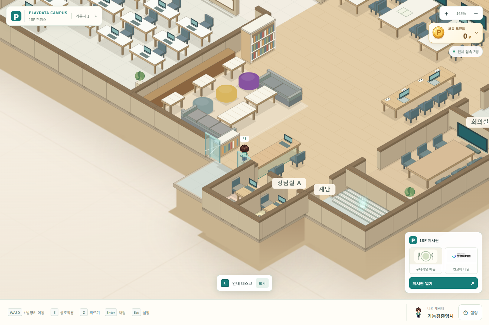
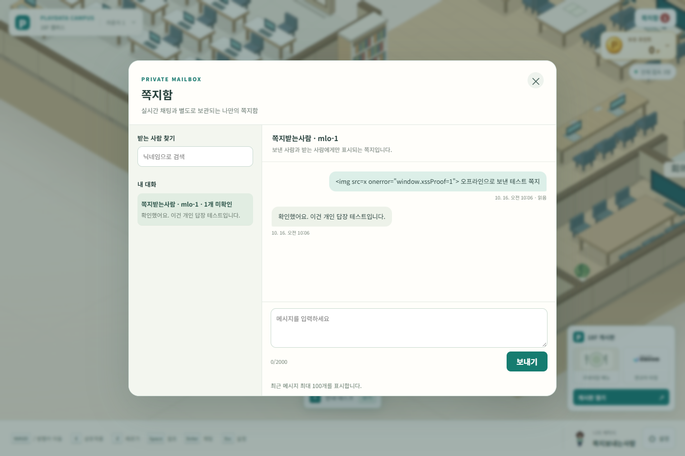
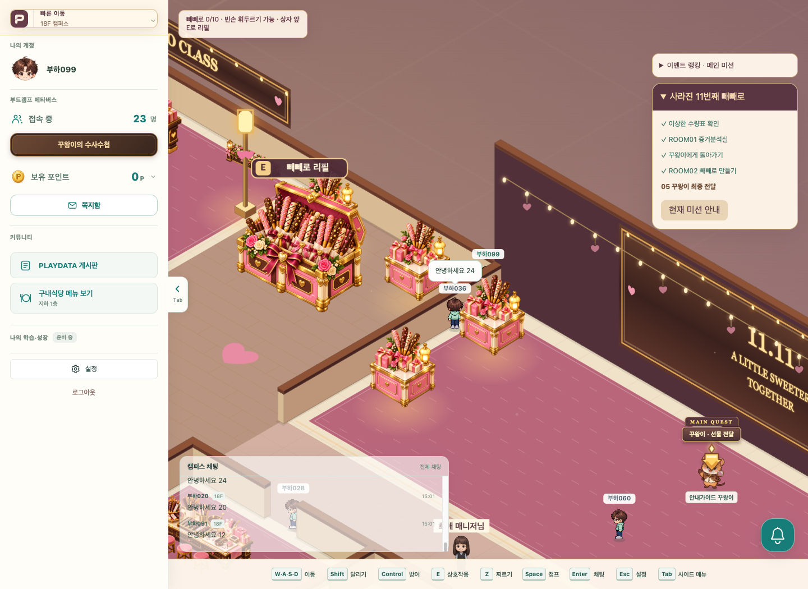
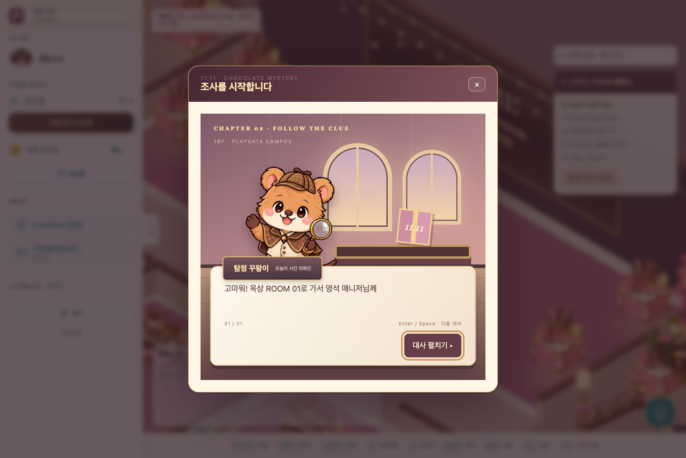
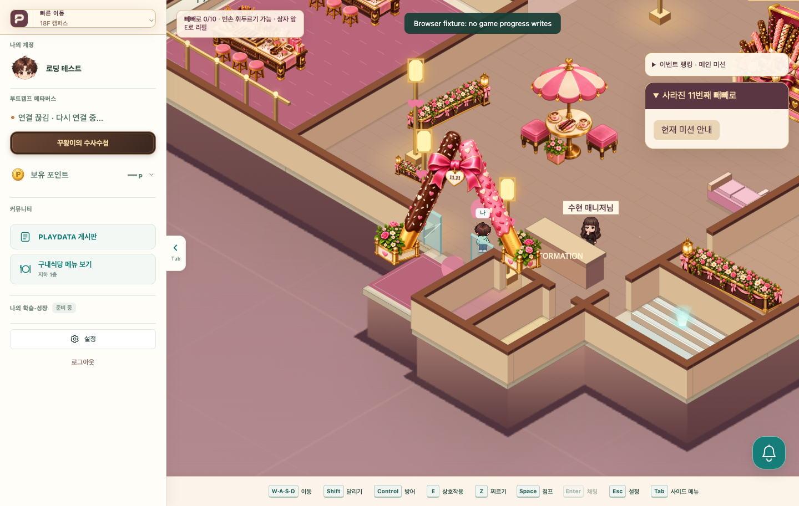

# 실제 실행 화면과 시연 자료

## 원본 시연 영상

[MP4 보기 또는 다운로드](../assets/videos/original-service-demo.mp4)

- 길이: 34.57초
- 해상도: 1920×940, H.264, 30fps
- 크기: 7,250,592바이트
- 원본: event 브랜치 docs/readme/README.md의 GitHub 첨부 영상
- 가져온 날짜: 2026년 11월 18일

원본 소개 문서의 영상 파일을 로그인된 브라우저에서 저장했습니다. 이 저장소의 MP4는 원본 비공개 저장소 접근 권한 없이 열람할 수 있습니다. 촬영 날짜와 개인 단독 제작 여부는 원본에 명시되지 않아 팀 서비스 시연으로 소개합니다.

## 원본 브라우저 캡처

개발·검증 당시 화면이며 최신 운영 버전이나 성능 수치를 증명하지 않습니다. 테스트와 fixture 조건을 아래에 구분했습니다.

### 캠퍼스 UI

UI 확인 캡처. 원본 경로: `docs/campus-ui-20261015/map.png`.

### 쪽지함

테스트 계정 간 대화와 입력 문자열 표시 확인. 원본 경로: `docs/campus-ui-20261016/private-mailbox.png`.

### 이벤트 맵

부하 시험 계정이 표시된 실제 브라우저 캡처. 원본 경로: `loadtest/results/20261106-backlog/baseline/chrome-real-after.png`.

### 게임 시작

검증 중 게임 시작 화면. 원본 경로: `loadtest/results/20261107-final/game-start-recovered.png`.

### 단계 완료

검증 중 게임 결과 화면. 원본 경로: `loadtest/results/20261107-final/game-result-recovered.png`.

### 조사 대사

검증 중 이벤트 대사 화면. 원본 경로: `loadtest/results/20261107-final/investigation-success.png`.

### 모바일 로딩

로딩 UI 테스트 화면. 원본 경로: `loadtest/results/20261107-loading-ui/browser-9k8hyhlb/loading-mobile.png`.

### 이벤트 진입 UI

fixture 화면. 진행 저장 없음·연결 끊김 표시가 있는 UI 테스트. 원본 경로: `loadtest/results/20261107-loading-ui/browser-9k8hyhlb/ready.png`.

## 홍보 자료와 설계 문서

[AI 홍보 이미지 포함 서비스 소개](../assets/overview/) · [메인 미션 ERD](reference/main-mission-erd.md) · [자료 출처](reference/source-materials.md)
