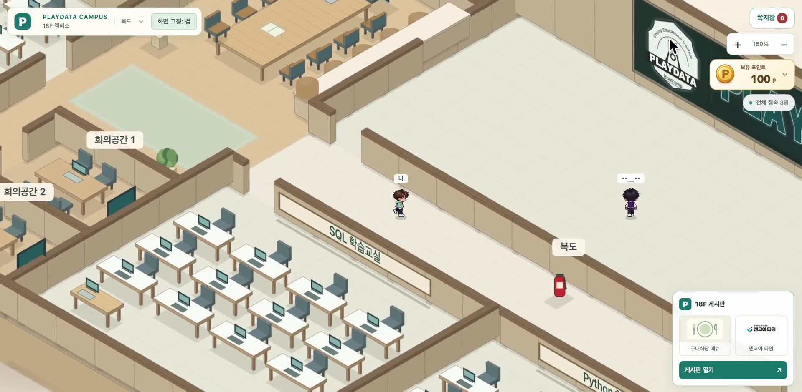
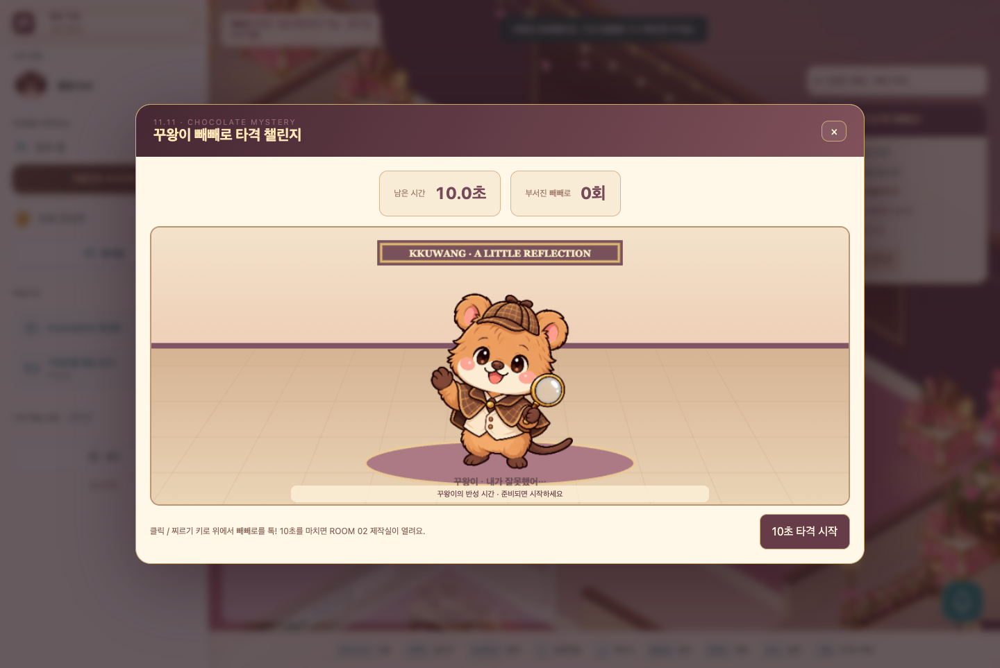
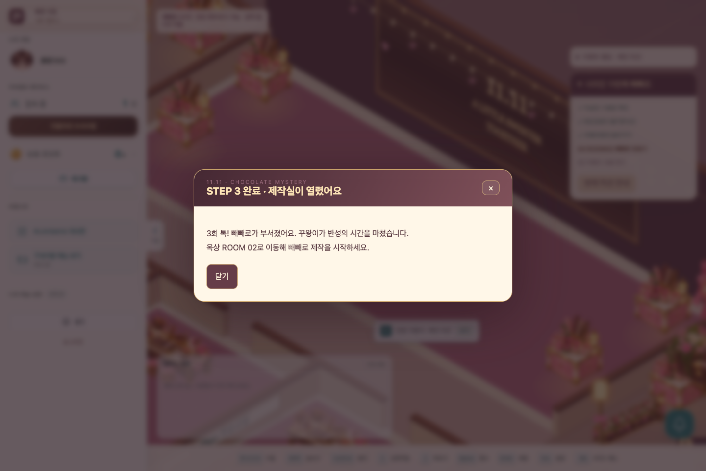
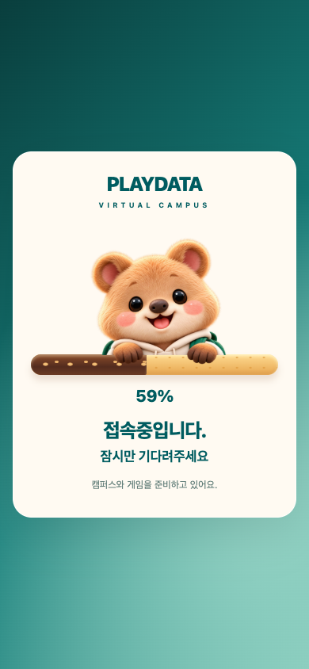

# 실제 실행 화면과 시연 자료

## 3차 기본 캠퍼스

18층 캠퍼스와 옥상을 자유롭게 이동하며, 게시판과 학습교실 등을 이용하는 상시 캠퍼스입니다. [3차 서비스 소개](https://github.com/encore-ai-campus/mlo-01-p3-team2/blob/main/PRODUCT.md)

### 기본 캠퍼스 시연 영상

[기본 캠퍼스 시연 영상 보기](../assets/videos/original-service-demo.mp4)

- 길이: 34.57초
- 해상도: 1920×940, H.264, 30fps
- 크기: 7,250,592바이트
- 원본: event 브랜치 docs/readme/README.md의 GitHub 첨부 영상
- 가져온 날짜: 2026년 11월 18일

영상은 기본 캠퍼스의 이동·게시판·옥상 장면을 담은 팀 서비스 시연입니다. [영상 자료 출처](reference/source-materials.md#실제-실행-자료-추가)

### 캠퍼스 UI

UI 확인 캡처. 원본 경로: `docs/campus-ui-20261015/map.png`.

### 쪽지함

테스트 계정 간 대화와 입력 문자열 표시 확인. 원본 경로: `docs/campus-ui-20261016/private-mailbox.png`.

### 캠퍼스 서비스 소개 자료

[학습교실, 게시판, 옥상 등 홍보용 이미지](../assets/overview/)에는 AI로 제작한 이미지가 포함됩니다. 위의 캠퍼스 UI와 쪽지함 사진은 브라우저 실행 캡처입니다.

## 4차 빼빼로데이 이벤트

기본 캠퍼스를 시즌 맵으로 바꿔 **‘사라진 11번째 빼빼로’** 추리 미션과 미니게임을 운영했습니다. 아래 화면에는 개발·부하 시험 당시의 장면이 포함됩니다. [이벤트 플레이 흐름과 화면](https://github.com/encore-ai-campus/mlo-01-p4-team2/blob/main/PRODUCT.md)

### 이벤트 맵

부하 시험 계정이 표시된 실제 브라우저 캡처. 원본 경로: `loadtest/results/20261106-backlog/baseline/chrome-real-after.png`.

### 게임 시작

검증 중 게임 시작 화면. 원본 경로: `loadtest/results/20261107-final/game-start-recovered.png`.

### 단계 완료

검증 중 게임 결과 화면. 원본 경로: `loadtest/results/20261107-final/game-result-recovered.png`.

### 조사 대사

검증 중 이벤트 대사 화면. 원본 경로: `loadtest/results/20261107-final/investigation-success.png`.

### 모바일 로딩

로딩 UI 테스트 화면. 원본 경로: `loadtest/results/20261107-loading-ui/browser-9k8hyhlb/loading-mobile.png`.

### 이벤트 진입 UI

fixture 화면. 진행 저장 없음·연결 끊김 표시가 있는 UI 테스트. 원본 경로: `loadtest/results/20261107-loading-ui/browser-9k8hyhlb/ready.png`.

### 행사 결과 대시보드

출처는 2026년 11월 12일 14:00:16 KST에 저장된 팀의 캠퍼스 이벤트 최종 집계와 발표용 정적 대시보드입니다. 집계 기간은 11월 11일부터 12일 14:00 KST까지입니다. 공개 캡처에는 참여 요약과 시간대별 그래프 영역을 담았습니다.

- **유효 접속 70개 계정**은 운영 시간에 유효 세션이 겹친 계정을 중복 제거한 값입니다. **활동 66개 계정**은 로그인·로그아웃 이외의 활동 기록을 남긴 계정 수입니다.
- **최다 활동 구간 36개 계정**은 11월 11일 12:50~14:00 구간에 접속해 활동한 고유 계정 수입니다.
- **공식 게임 시작 1,463회**는 게임을 시작한 횟수이며 같은 계정의 재도전도 집계합니다. **공개 채팅 883건**은 공개 채팅 발신 기록의 합계입니다.
- **메인 미션 완료율 77.8%**의 분모는 집계 기간에 첫 조사 단계를 완료한 63개 계정입니다. 이 중 49개 계정이 최종 전달을 마쳤습니다.

팀의 동시 접속 시험과 응답 시간 측정은 [4차 성능 개선과 검증](https://github.com/encore-ai-campus/mlo-01-p4-team2#성능-개선과-검증)에 기록했습니다.

## 설계 문서와 원본 출처

[메인 미션 ERD](reference/main-mission-erd.md) · [자료 출처](reference/source-materials.md)
