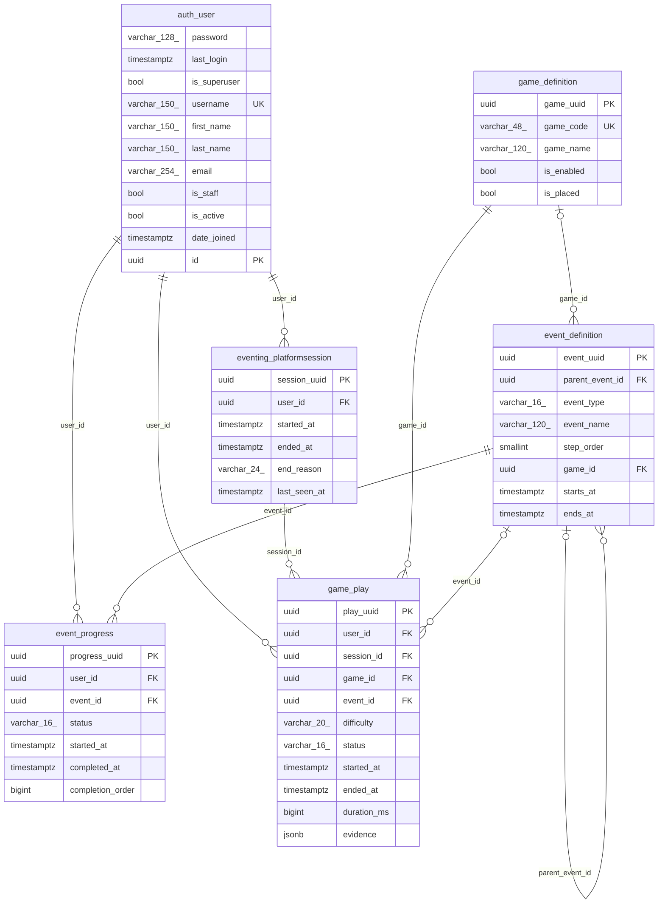
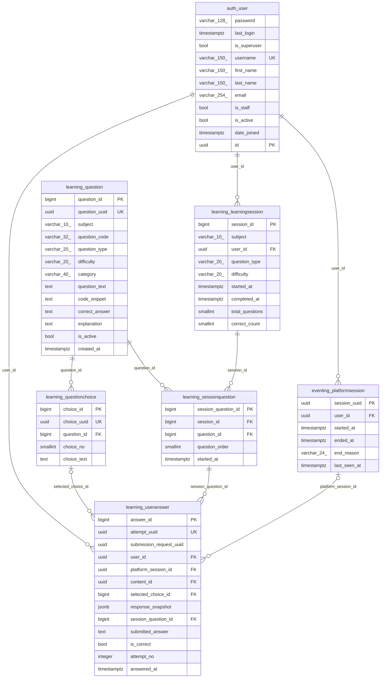
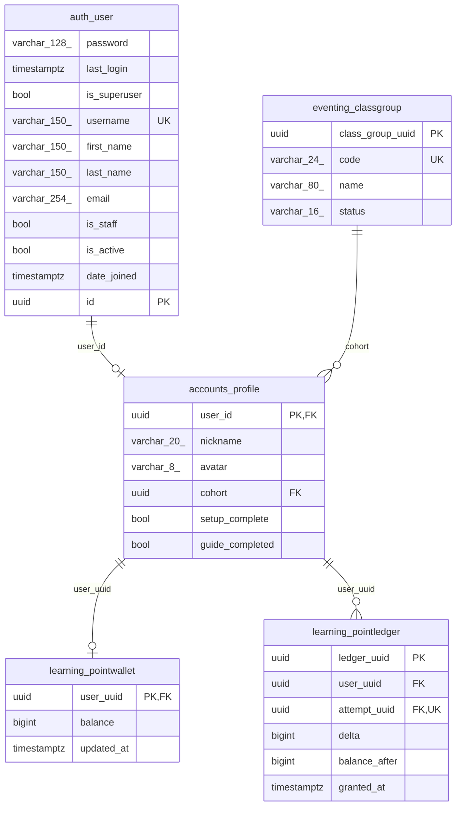
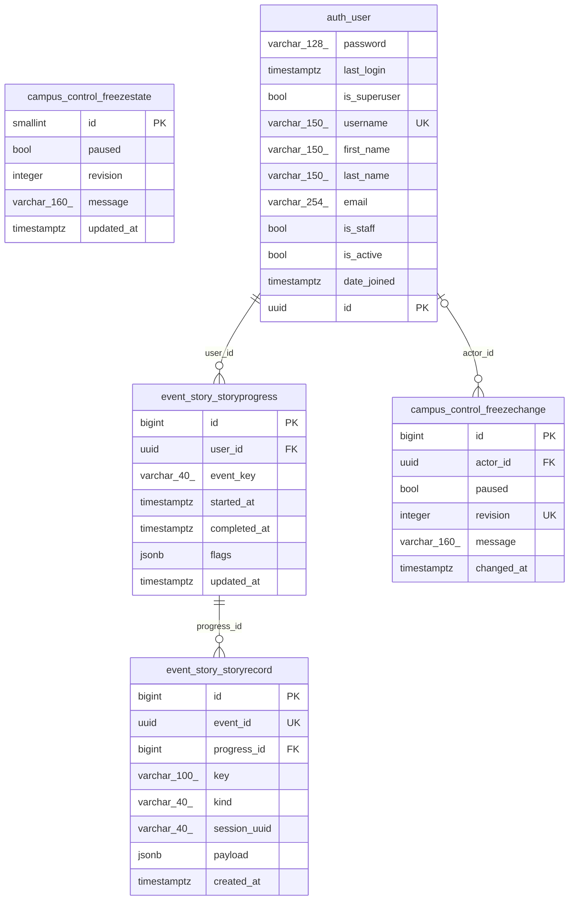
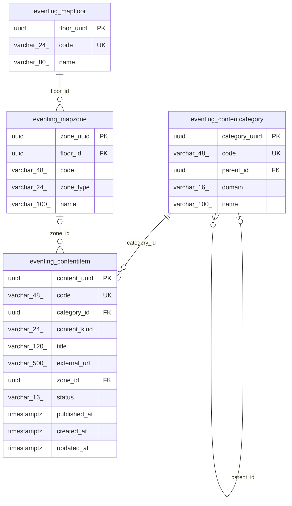

# 메인 미션 구현 ERD · PostgreSQL

Room2: 카드 뒤집기 → 초콜릿 코팅 → 토핑 뿌리기 → 포장 완료. 타이핑은 메인 제작 과정에서 제외했다.

실제 로컬 PostgreSQL의 23개 관련 테이블, 162개 컬럼을 모델·pg_catalog와 대조했다. 실제 계정/답안 값은 포함하지 않는다.

## 범위와 해석

- 신규 메인 저장 구조: event_definition, event_progress, game_definition, game_play. 회차 테이블/run_uuid 없음.
- 기존 Python 채점, 포인트 적립, 접속 이력, 일일 안내·프리즈에서 참조하는 테이블도 모두 포함한다. 기존 참조 테이블은 미사용 컬럼도 실제 구조 확인용으로 함께 표시했다.
- 계정 FK user_id의 실제 타입은 UUID이며 auth_user.id를 참조한다. 별도 프로필 UUID 컬럼을 추가하지 않았다.
- event_progress는 현재 단계 상태, game_play는 한 판의 시작/결과이다. 게임 성공과 단계 완료는 같은 트랜잭션에서 반영한다.
- game_play.event_id=NULL은 연습 게임이다. 메인 단계와 랭킹을 갱신하지 않는다.
- StoryProgress/StoryRecord는 이번 새 메인에서는 일일 안내 노출 기록에만 쓰며 레거시 flags로 새 진행을 판단하지 않는다.
- score-only 꾸왕이 게임은 FINISHED이며 STEP 04 완료 조건은 여전히 잠금이다.
- 포장 애니메이션은 4.5초이며, 서버가 시간과 네 단계 순서를 확인한 뒤 완료한다.
- 토핑 뿌리기는 30초 동안 12개 이상, 40개 중 수집한다. 시작 challenge의 rulesVersion=2.
- JSON evidence는 실제 컬럼 하나이고 아래 proof 항목들은 별도 물리 컬럼이 아니다.

## 관계도

### 메인 진행·게임 기록

### Python 학습·채점

### 계정 프로필·포인트

### 일일 안내·프리즈

### 학습 콘텐츠 참조

## 모든 컬럼

### auth_user

UUID 계정. 비밀번호 등 인증 컬럼은 구조만 표시하며 값은 포함하지 않음

| DB 컬럼 | PostgreSQL 타입 | 키 | NULL | 의미/참조 |
|---|---|---|---|---|
| password | character varying(128) |  | 불가 | 인증용 비밀번호 해시 컬럼. 문서에 실제 값은 포함하지 않음 |
| last_login | timestamp with time zone |  | 허용 | 마지막 로그인 |
| is_superuser | boolean |  | 불가 | 최상위 사용자 권한 |
| username | character varying(150) | UK | 불가 | 사용자 이름 |
| first_name | character varying(150) |  | 불가 | 이름 |
| last_name | character varying(150) |  | 불가 | 성 |
| email | character varying(254) |  | 불가 | 이메일 주소 |
| is_staff | boolean |  | 불가 | 스태프 권한 |
| is_active | boolean |  | 불가 | 활성 |
| date_joined | timestamp with time zone |  | 불가 | 등록일 |
| id | uuid | PK | 불가 | id |
- 복합/고유 제약: `username`

### eventing_platformsession

platform session

| DB 컬럼 | PostgreSQL 타입 | 키 | NULL | 의미/참조 |
|---|---|---|---|---|
| session_uuid | uuid | PK | 불가 | 접속 이력 키. StoryRecord에서는 문자열이며 FK가 아님 |
| user_id | uuid | FK | 불가 | UUID 계정 FK → auth_user.id |
| started_at | timestamp with time zone |  | 불가 | started at |
| ended_at | timestamp with time zone |  | 허용 | ended at |
| end_reason | character varying(24) |  | 허용 | end reason |
| last_seen_at | timestamp with time zone |  | 불가 | last seen at |

### game_definition

내부 게임 실행 코드와 활성·배치 상태

| DB 컬럼 | PostgreSQL 타입 | 키 | NULL | 의미/참조 |
|---|---|---|---|---|
| game_uuid | uuid | PK | 불가 | game uuid |
| game_code | character varying(48) | UK | 불가 | JS 실행 함수와 연결하는 고정 코드 |
| game_name | character varying(120) |  | 불가 | game name |
| is_enabled | boolean |  | 불가 | 새 게임 시작 허용 여부 |
| is_placed | boolean |  | 불가 | 배치 현황 표시. 실제 맵 오브젝트와 별개 메타데이터 |
- 복합/고유 제약: `game_code`

### event_definition

행사·대표 단계·세부 제작 공정의 정의

| DB 컬럼 | PostgreSQL 타입 | 키 | NULL | 의미/참조 |
|---|---|---|---|---|
| event_uuid | uuid | PK | 불가 | 이벤트 항목 UUID |
| parent_event_id | uuid | FK | 허용 | 부모 항목. 대표 STEP은 행사 아래, 제작 공정은 STEP 05 아래 → event_definition.event_uuid |
| event_type | character varying(16) |  | 불가 | event type |
| event_name | character varying(120) |  | 불가 | event name |
| step_order | smallint |  | 허용 | 같은 부모 아래의 순서. 현재 제작 공정 1~4 |
| game_id | uuid | FK | 허용 | 실행 게임. 대화/전달 단계는 NULL → game_definition.game_uuid |
| starts_at | timestamp with time zone |  | 허용 | 행사 기간 보관. 현재 시간 판정은 main.window()의 운영 시간표 사용 |
| ends_at | timestamp with time zone |  | 허용 | 행사 기간 보관. 현재 시간 판정은 main.window()의 운영 시간표 사용 |
- 복합/고유 제약: `parent_event_id, step_order`

### event_progress

계정별 최초 진입·완료 상태와 최종 순번

| DB 컬럼 | PostgreSQL 타입 | 키 | NULL | 의미/참조 |
|---|---|---|---|---|
| progress_uuid | uuid | PK | 불가 | progress uuid |
| user_id | uuid | FK | 불가 | UUID 계정 FK → auth_user.id |
| event_id | uuid | FK | 불가 | 연결된 단계. 연습 모드의 game_play에서는 NULL → event_definition.event_uuid |
| status | character varying(16) |  | 불가 | IN_PROGRESS / COMPLETED (행 없음은 미시작) |
| started_at | timestamp with time zone |  | 불가 | started at |
| completed_at | timestamp with time zone |  | 허용 | completed at |
| completion_order | bigint |  | 허용 | 최초 최종 전달 순번. 재전송 시 유지 |
- 복합/고유 제약: `user_id, event_id`
- 복합/고유 제약: `event_id, completion_order`

### game_play

한 판의 시작·종료·판정 근거·점수 기록

| DB 컬럼 | PostgreSQL 타입 | 키 | NULL | 의미/참조 |
|---|---|---|---|---|
| play_uuid | uuid | PK | 불가 | 한 판과 결과 재전송을 식별하는 키 |
| user_id | uuid | FK | 불가 | UUID 계정 FK → auth_user.id |
| session_id | uuid | FK | 불가 | session → eventing_platformsession.session_uuid |
| game_id | uuid | FK | 불가 | 실행 게임. 대화/전달 단계는 NULL → game_definition.game_uuid |
| event_id | uuid | FK | 허용 | 연결된 단계. 연습 모드의 game_play에서는 NULL → event_definition.event_uuid |
| difficulty | character varying(20) |  | 허용 | 현재 이벤트 게임에서는 난이도를 고르지 않아 NULL |
| status | character varying(16) |  | 불가 | RUNNING / SUCCESS / FAILED / INTERRUPTED / FINISHED(터치 점수만) |
| started_at | timestamp with time zone |  | 불가 | started at |
| ended_at | timestamp with time zone |  | 허용 | ended at |
| duration_ms | bigint |  | 허용 | 시작 승인부터 종료 확정까지 서버 경과시간(ms) |
| evidence | jsonb |  | 불가 | 시작 challenge + 결과 proof, 터치 게임은 score 포함 |

### learning_learningsession

Python 초급 객관식 10문항의 서버 채점 결과를 STEP 02에 반영

| DB 컬럼 | PostgreSQL 타입 | 키 | NULL | 의미/참조 |
|---|---|---|---|---|
| session_id | bigint | PK | 불가 | session id |
| subject | character varying(10) |  | 불가 | python / sql |
| user_id | uuid | FK | 불가 | UUID 계정 FK → auth_user.id |
| question_type | character varying(20) |  | 불가 | multiple_choice / fill_blank |
| difficulty | character varying(20) |  | 불가 | 현재 이벤트 게임에서는 난이도를 고르지 않아 NULL |
| started_at | timestamp with time zone |  | 불가 | started at |
| completed_at | timestamp with time zone |  | 허용 | completed at |
| total_questions | smallint |  | 불가 | 메인 Python 기준 10문항 |
| correct_count | smallint |  | 불가 | 서버가 확정한 정답 수 |

### learning_sessionquestion

session question

| DB 컬럼 | PostgreSQL 타입 | 키 | NULL | 의미/참조 |
|---|---|---|---|---|
| session_question_id | bigint | PK | 불가 | session question id |
| session_id | bigint | FK | 불가 | session → learning_learningsession.session_id |
| question_id | bigint | FK | 불가 | question → learning_question.question_id |
| question_order | smallint |  | 불가 | 세트 안 문항 순서 |
| started_at | timestamp with time zone |  | 허용 | started at |
- 복합/고유 제약: `session_id, question_id`
- 복합/고유 제약: `session_id, question_order`

### learning_question

question

| DB 컬럼 | PostgreSQL 타입 | 키 | NULL | 의미/참조 |
|---|---|---|---|---|
| question_id | bigint | PK | 불가 | question id |
| question_uuid | uuid | UK | 불가 | question uuid |
| subject | character varying(10) |  | 불가 | python / sql |
| question_code | character varying(32) |  | 허용 | question code |
| question_type | character varying(20) |  | 불가 | multiple_choice / fill_blank |
| difficulty | character varying(20) |  | 불가 | 현재 이벤트 게임에서는 난이도를 고르지 않아 NULL |
| category | character varying(40) |  | 불가 | category |
| question_text | text |  | 불가 | 문제의 질문 |
| code_snippet | text |  | 허용 | 문제 코드 |
| correct_answer | text |  | 불가 | 서버 채점 정답. 일반 미션 상태 응답으로 공개하지 않음 |
| explanation | text |  | 불가 | 문제 해설 |
| is_active | boolean |  | 불가 | is active |
| created_at | timestamp with time zone |  | 불가 | created at |
- 복합/고유 제약: `subject, question_code`
- 복합/고유 제약: `question_uuid`

### learning_questionchoice

question choice

| DB 컬럼 | PostgreSQL 타입 | 키 | NULL | 의미/참조 |
|---|---|---|---|---|
| choice_id | bigint | PK | 불가 | choice id |
| choice_uuid | uuid | UK | 불가 | choice uuid |
| question_id | bigint | FK | 불가 | question → learning_question.question_id |
| choice_no | smallint |  | 불가 | 객관식 보기 번호 |
| choice_text | text |  | 불가 | 객관식 보기 내용 |
- 복합/고유 제약: `question_id, choice_no`
- 복합/고유 제약: `choice_uuid`

### learning_useranswer

문항별 각 제출·채점 결과. 정답 제출은 포인트 지급과 연결

| DB 컬럼 | PostgreSQL 타입 | 키 | NULL | 의미/참조 |
|---|---|---|---|---|
| answer_id | bigint | PK | 불가 | answer id |
| attempt_uuid | uuid | UK | 불가 | 제출 UUID. 포인트 원장이 이 고유 컬럼을 참조 |
| submission_request_uuid | uuid |  | 허용 | 답안 재전송 중복 방지 키 |
| user_id | uuid | FK | 불가 | UUID 계정 FK → auth_user.id |
| platform_session_id | uuid | FK | 허용 | platform session → eventing_platformsession.session_uuid |
| content_id | uuid | FK | 허용 | content → eventing_contentitem.content_uuid |
| selected_choice_id | bigint | FK | 허용 | 선택한 객관식 보기. 빈칸 문제는 NULL → learning_questionchoice.choice_id |
| response_snapshot | jsonb |  | 불가 | 당시 응답 정보 스냅샷 |
| session_question_id | bigint | FK | 불가 | session question → learning_sessionquestion.session_question_id |
| submitted_answer | text |  | 불가 | 사용자가 제출한 값 |
| is_correct | boolean |  | 불가 | 서버 채점 결과 |
| attempt_no | integer |  | 불가 | 해당 문항의 제출 차수. 기존 최대 3회 |
| answered_at | timestamp with time zone |  | 불가 | answered at |
- 복합/고유 제약: `attempt_uuid`
- 복합/고유 제약: `session_question_id, attempt_no`
- 복합/고유 제약: `user_id, submission_request_uuid`

### accounts_profile

profile

| DB 컬럼 | PostgreSQL 타입 | 키 | NULL | 의미/참조 |
|---|---|---|---|---|
| user_id | uuid | PK/FK | 불가 | UUID 계정 FK → auth_user.id |
| nickname | character varying(20) |  | 불가 | UI·랭킹에 표시하는 닉네임 |
| avatar | character varying(8) |  | 불가 | 캐릭터 선택 |
| cohort | uuid | FK | 불가 | 과정/기수 FK → eventing_classgroup.class_group_uuid |
| setup_complete | boolean |  | 불가 | 캐릭터 설정 완료 여부 |
| guide_completed | boolean |  | 불가 | 초기 안내 완료 여부 |

### eventing_classgroup

class group

| DB 컬럼 | PostgreSQL 타입 | 키 | NULL | 의미/참조 |
|---|---|---|---|---|
| class_group_uuid | uuid | PK | 불가 | class group uuid |
| code | character varying(24) | UK | 불가 | code |
| name | character varying(80) |  | 불가 | name |
| status | character varying(16) |  | 불가 | status |
- 복합/고유 제약: `code`

### learning_pointwallet

point wallet

| DB 컬럼 | PostgreSQL 타입 | 키 | NULL | 의미/참조 |
|---|---|---|---|---|
| user_uuid | uuid | PK/FK | 불가 | 실제 DB 컬럼명. 프로필/포인트 계정 UUID 참조 → accounts_profile.user_id |
| balance | bigint |  | 불가 | 보유 포인트 |
| updated_at | timestamp with time zone |  | 불가 | updated at |

### learning_pointledger

point ledger

| DB 컬럼 | PostgreSQL 타입 | 키 | NULL | 의미/참조 |
|---|---|---|---|---|
| ledger_uuid | uuid | PK | 불가 | ledger uuid |
| user_uuid | uuid | FK | 불가 | 실제 DB 컬럼명. 프로필/포인트 계정 UUID 참조 → accounts_profile.user_id |
| attempt_uuid | uuid | FK/UK | 불가 | 제출 UUID. 포인트 원장이 이 고유 컬럼을 참조 → learning_useranswer.attempt_uuid |
| delta | bigint |  | 불가 | 적립량 |
| balance_after | bigint |  | 불가 | 적립 후 잔액 |
| granted_at | timestamp with time zone |  | 불가 | 적립 확정 시각 |
- 복합/고유 제약: `attempt_uuid`

### event_story_storyprogress

새 메인 단계에는 사용하지 않음. 일일 안내 노출 묶음만 사용

| DB 컬럼 | PostgreSQL 타입 | 키 | NULL | 의미/참조 |
|---|---|---|---|---|
| id | bigint | PK | 불가 | ID |
| user_id | uuid | FK | 불가 | UUID 계정 FK → auth_user.id |
| event_key | character varying(40) |  | 불가 | 일일 안내 묶음 pepero-2026-ui-notices |
| started_at | timestamp with time zone |  | 허용 | 레거시 칼럼. 현재 일일 안내 및 새 메인 완료 판정에 사용하지 않음 |
| completed_at | timestamp with time zone |  | 허용 | 레거시 칼럼. 현재 일일 안내 및 새 메인 완료 판정에 사용하지 않음 |
| flags | jsonb |  | 불가 | 레거시 칼럼. 현재 일일 안내 및 새 메인 완료 판정에 사용하지 않음 |
| updated_at | timestamp with time zone |  | 불가 | updated at |
- 복합/고유 제약: `user_id, event_key`

### event_story_storyrecord

일일 안내를 계정·날짜별로 한 번 기록

| DB 컬럼 | PostgreSQL 타입 | 키 | NULL | 의미/참조 |
|---|---|---|---|---|
| id | bigint | PK | 불가 | ID |
| event_id | uuid | UK | 불가 | 연결된 단계. 연습 모드의 game_play에서는 NULL |
| progress_id | bigint | FK | 불가 | progress → event_story_storyprogress.id |
| key | character varying(100) |  | 불가 | 일일 안내에서는 한국시간 날짜 문자열 |
| kind | character varying(40) |  | 불가 | 현재 일일 안내: daily_notice |
| session_uuid | character varying(40) |  | 불가 | 접속 이력 키. StoryRecord에서는 문자열이며 FK가 아님 |
| payload | jsonb |  | 불가 | payload |
| created_at | timestamp with time zone |  | 불가 | created at |
- 복합/고유 제약: `event_id`
- 복합/고유 제약: `progress_id, key`

### campus_control_freezestate

freeze state

| DB 컬럼 | PostgreSQL 타입 | 키 | NULL | 의미/참조 |
|---|---|---|---|---|
| id | smallint | PK | 불가 | id |
| paused | boolean |  | 불가 | 공통 이용 정지 여부 |
| revision | integer |  | 불가 | 정지 상태 변경 순번 / 충돌 검사 |
| message | character varying(160) |  | 불가 | 정지 사유 안내 |
| updated_at | timestamp with time zone |  | 불가 | updated at |

### campus_control_freezechange

freeze change

| DB 컬럼 | PostgreSQL 타입 | 키 | NULL | 의미/참조 |
|---|---|---|---|---|
| id | bigint | PK | 불가 | ID |
| actor_id | uuid | FK | 허용 | 정지를 변경한 관리자 → auth_user.id |
| paused | boolean |  | 불가 | 공통 이용 정지 여부 |
| revision | integer | UK | 불가 | 정지 상태 변경 순번 / 충돌 검사 |
| message | character varying(160) |  | 불가 | 정지 사유 안내 |
| changed_at | timestamp with time zone |  | 불가 | changed at |
- 복합/고유 제약: `revision`

### eventing_contentitem

content item

| DB 컬럼 | PostgreSQL 타입 | 키 | NULL | 의미/참조 |
|---|---|---|---|---|
| content_uuid | uuid | PK | 불가 | content uuid |
| code | character varying(48) | UK | 불가 | code |
| category_id | uuid | FK | 불가 | category → eventing_contentcategory.category_uuid |
| content_kind | character varying(24) |  | 불가 | content kind |
| title | character varying(120) |  | 불가 | title |
| external_url | character varying(500) |  | 허용 | external url |
| zone_id | uuid | FK | 허용 | zone → eventing_mapzone.zone_uuid |
| status | character varying(16) |  | 불가 | status |
| published_at | timestamp with time zone |  | 허용 | published at |
| created_at | timestamp with time zone |  | 불가 | created at |
| updated_at | timestamp with time zone |  | 불가 | updated at |
- 복합/고유 제약: `code`

### eventing_contentcategory

content category

| DB 컬럼 | PostgreSQL 타입 | 키 | NULL | 의미/참조 |
|---|---|---|---|---|
| category_uuid | uuid | PK | 불가 | category uuid |
| code | character varying(48) | UK | 불가 | code |
| parent_id | uuid | FK | 허용 | parent → eventing_contentcategory.category_uuid |
| domain | character varying(16) |  | 불가 | domain |
| name | character varying(100) |  | 불가 | name |
- 복합/고유 제약: `code`

### eventing_mapzone

map zone

| DB 컬럼 | PostgreSQL 타입 | 키 | NULL | 의미/참조 |
|---|---|---|---|---|
| zone_uuid | uuid | PK | 불가 | zone uuid |
| floor_id | uuid | FK | 불가 | floor → eventing_mapfloor.floor_uuid |
| code | character varying(48) |  | 불가 | code |
| zone_type | character varying(24) |  | 불가 | zone type |
| name | character varying(100) |  | 불가 | name |
- 복합/고유 제약: `floor_id, code`

### eventing_mapfloor

map floor

| DB 컬럼 | PostgreSQL 타입 | 키 | NULL | 의미/참조 |
|---|---|---|---|---|
| floor_uuid | uuid | PK | 불가 | floor uuid |
| code | character varying(24) | UK | 불가 | code |
| name | character varying(80) |  | 불가 | name |
- 복합/고유 제약: `code`

## game_play.evidence 내부 계약

| 게임 | challenge | result |
|---|---|---|
| SQL 기억 | seed, problem | success, rounds: 라운드별 입력 순서 |
| 카드 | seed, deck | success, picks: 선택 인덱스 쌍 |
| 코팅 | seed | success, taps: 입력 시각(ms) |
| 토핑 | seed, durationMs, minCatch=12, catchRadius=82, rulesVersion=2 | success, caught: id·at(ms)·x |
| 포장 | seed, durationMs=4500, sequence, rulesVersion=2 | success, animationMs, sequence |
| 꾸왕이 터치 | seed, durationMs=10000 | taps: 터치 시각. score는 evidence.score에 보관 |

## 물리 컬럼이 아닌 값

- 현재 대표 단계(stage), steps/games 완료 배열, 현재 목적지: event_progress에서 계산.
- 근접 인증 ticket과 게임 token: 서버 서명 값, 별도 DB 컬럼 없음.
- Room1/Room2 내부 좌표·충돌·작업대 표시: 프론트 개인 공간 로컬 상태. 게임 결과만 서버에 저장.
- 일일 안내에서는 StoryRecord.session_uuid가 문자열 컬럼이며 PlatformSession과 FK로 연결되지 않는다.
- 이번 ERD에는 채팅·쪽지·게시판·이스터에그 데이터는 포함하지 않는다.
