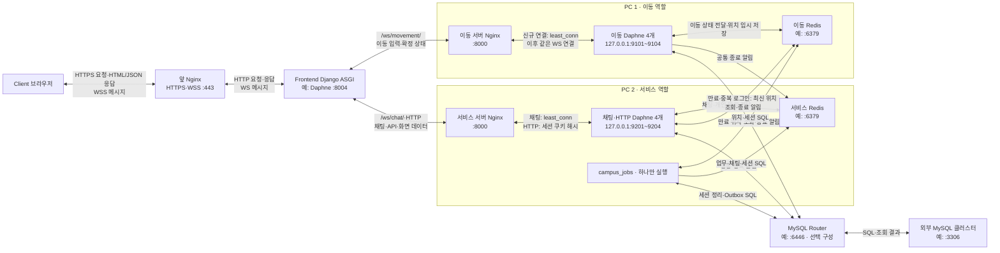
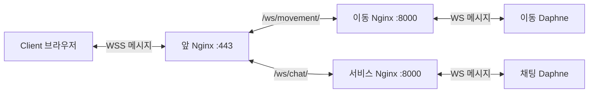
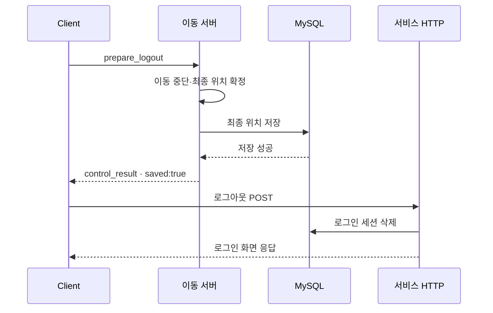

# 플랫폼 요청 흐름 원본 발췌

원본 `event` 브랜치의 `platform-diagram.md` 중 1~3절입니다. Redis 분리 #11과 로그아웃 ACK #12 시점의 설계 설명이며, MySQL 기반 과거 구성과 배포 예시를 포함합니다. 현재 PostgreSQL 구성이나 실제 운영 배치를 나타내는 문서로 해석하지 않습니다.

## 1. 전체 흐름

### 프론트 중계 경로

- **HTTP 화면:** 백엔드가 화면용 JSON을 반환하고, 프론트가 HTML을 만든다.
- **HTTP API:** 프론트가 백엔드 응답을 전달한다.
- **WebSocket:** `101 Upgrade` 후 같은 연결로 양방향 메시지를 전달한다.
- **응답 경로:** 요청을 중계한 연결을 거슬러 브라우저로 돌아간다.
- **정적 파일:** 실제 운영 Nginx의 서빙 경로는 확인하지 않았다.
- **공통 종료 알림:** 로그아웃·세션 만료·중복 로그인을 두 Redis에 각각 알린다.
- **Redis:** 두 인스턴스는 역할별 저장소다. 이 배치는 Redis 복제·자동 장애 전환을 포함하지 않는다.
- **DB:** Router를 사용하지 않으면 앱이 외부 MySQL의 지정 주소로 직접 연결한다.

### WebSocket 직접 전달 경로

- 직접 전달하면 WebSocket은 프론트 Python을 통과하지 않는다.
- 이동·채팅 분리 경로의 운영 적용은 확인하지 않았다.
- 과거 운영 기록은 `/ws/campus/`의 직접 전달만 확인한다.

## 2. 라우팅·입출력·포트

| 구성요소 | 입력 → 출력 | 선택 기준·예시 포트 |
|---|---|---|
| 앞 Nginx | HTTPS·WSS → 내부 HTTP·WS | 외부 `443` · 프론트 또는 경로별 백엔드 |
| Frontend | HTTP → 화면용 JSON·HTML·API 응답 / WS ↔ WS | `8004` · `BACKEND_URL`, `MOVEMENT_BACKEND_URL` |
| 이동 Nginx | 이동 WS ↔ 이동 프로세스 | `8000` → 로컬 `9101~9104` · 연결 수 기준 |
| 서비스 Nginx | HTTP·채팅 WS ↔ 서비스 프로세스 | `8000` → 로컬 `9201~9204` · 쿠키 해시·연결 수 기준 |
| 이동 Redis | 이동 상태 전달·최신 위치 임시 저장 | `CAMPUS_MOVEMENT_REDIS_URL` · 예: `6379` |
| 서비스 Redis | 채팅·개인 알림 전달 | `CAMPUS_SERVICE_REDIS_URL` · 예: `6379` |
| MySQL Router | 앱의 SQL ↔ MySQL | `6446`은 기존 운영 기록 · 현재 주소 미확인 |
| MySQL | SQL → 저장·조회 결과 | `3306`은 설정 예시 · 현재 주소 미확인 |

- 표의 포트는 **받는 서버의 목적지 포트**다. 요청을 보내는 연결의 출발 포트는 OS가 임시 배정한다.
- `127.0.0.1`은 **같은 서버 안**에서만 연결한다.
- 서로 다른 서버는 사설 IP·내부 DNS로 연결한다.
- 이동·채팅 WebSocket은 각각 연결 시 프로세스를 선택한다.
- 연결 중인 메시지를 매번 다른 프로세스에 배정하지 않는다.
- Nginx worker 수와 프론트의 실제 프로세스 수는 확인하지 않았다.

## 3. 로그아웃 순서

> 정상 로그아웃은 이동 서버의 실제 DB 저장 성공 응답을 기다린다. 오류 응답·시간 초과이면 POST를 보내지 않는다.

- ACK는 저장 완료 응답이다. 저장 실패·시간 초과 시 POST를 보류한다.
- 프론트 중계·Nginx 경유 단계는 순서를 보여주려고 생략했다.
- 일반 로그아웃 HTTP에서 이동 Redis의 위치 조회를 제거한다.
- 저장 실패 후 재시도할 수 있다. 저장 완료 요청의 재전송은 같은 성공 응답을 반환한다.
- 저장 완료 후 이동 입력을 차단해 확정 위치를 유지한다.
- 자동 만료·중복 로그인·jobs는 이동 위치 조회와 양쪽 Redis 알림 경로를 유지한다.
